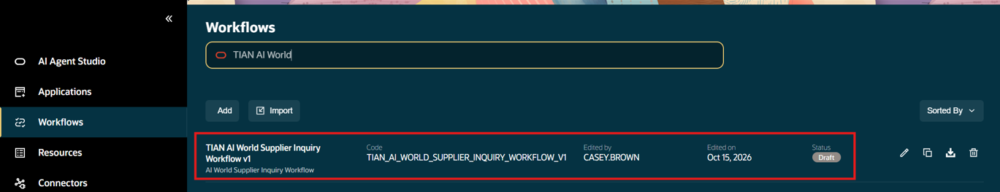
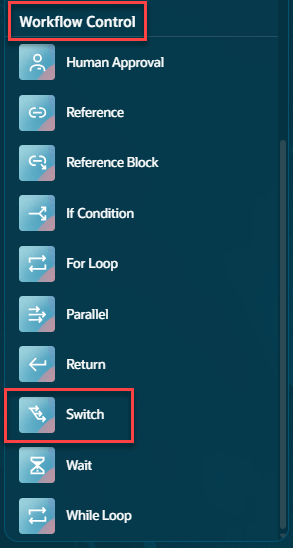
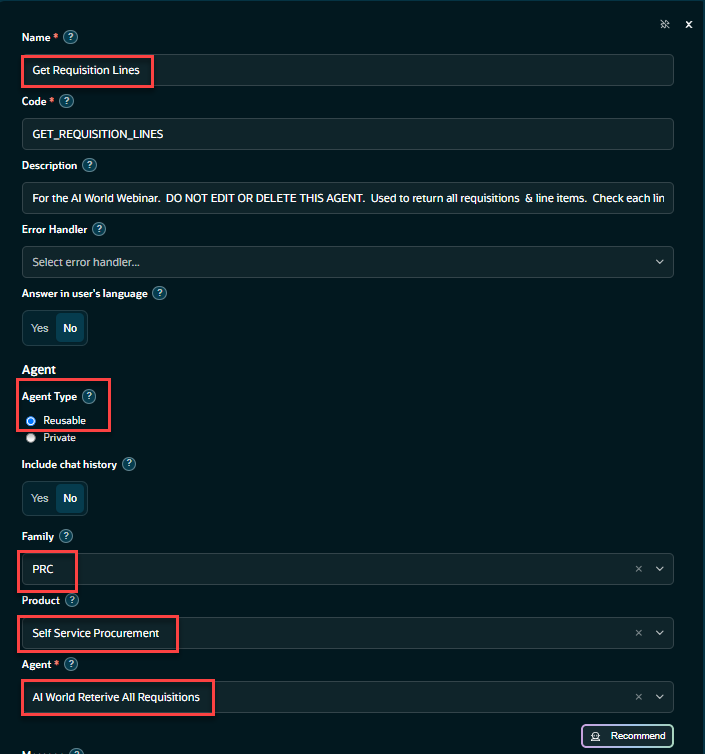
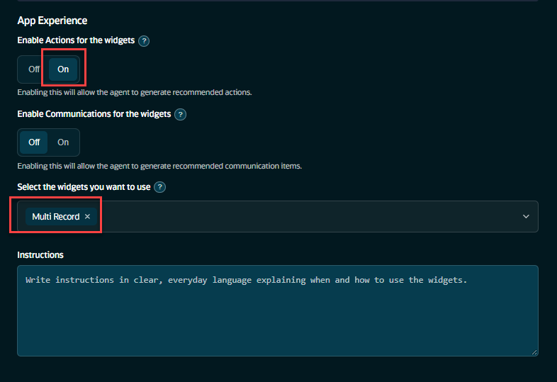
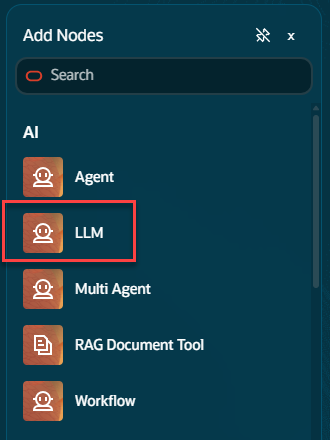
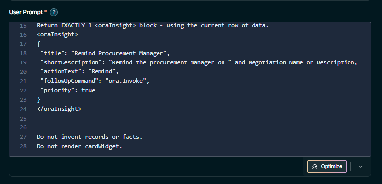
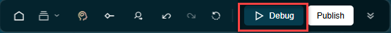
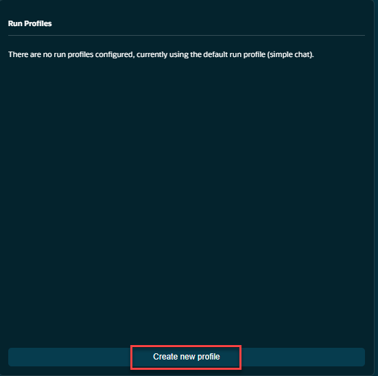
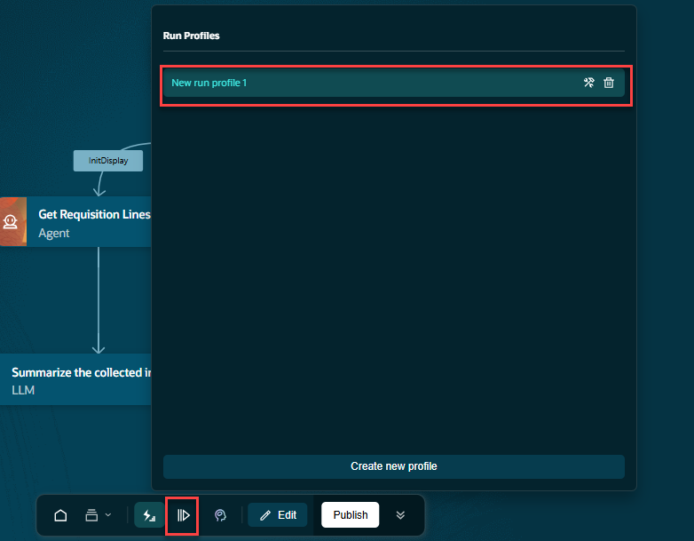
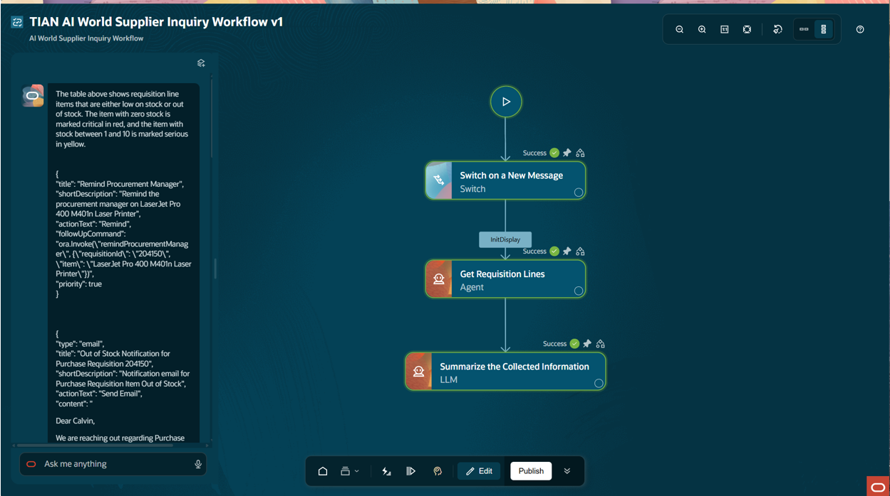

# Configure Your Workflow

## Introduction

In this lab we will continue build and configure the agentic workflow that we started in Lab #1.</br>
We will build the workflow, test the workflow, and publish it making it available to be leveraged</br>
by the agentic application(s).</br></br>
An agentic workflow can be leveraged by one or more agentic applications promoting reuse of commonly used functionality.</br></br>
Estimated Time: 30 minutes

### Objectives

Understand the structure of a pre-built workflow template and agent tools in AI Agent Studio.

### Usage Notes
When creating workflows and agentic applications, all artifacts must have a unique name.</br>
To ensure your components have a unique name, please use an initial code when naming your components.</br>
Take the first two letters of your first name and last two letters of your last name to form a unique code.</br>
If this spells out a common word, add a number.

   [](include:initial_hints)

## Task 1: Open Your Workflow to Edit it
Reopen your ***[Initials]*** **AI World Supplier Inquiry Workflow** by clicking on the edit icon.


## Task 2: Add the Switch Node to the Workflow
We will add the first node to the workflow.  The switch node will direct incoming messages from the agentic</br>
application to the correct branch in the workflow.</br>
At the bottom of the page, from the menu bar, click on the **Component Pallette Button**</br>

The Node pallette should appear on the left side of the screen.  Scroll down to **Workflow Control** and click on the **Switch** node.</br>
The node will appear on the pallette and it's configuration dialog will open.


1. Configure the switch node</br>
Name: **Switch on a New Message**</br>
Description: **Switch on a New Message**</br>
Case Expression: ***{{$context.$app.$OraMessageHint}}***</br>

You can copy this value here and paste it into the **Case Expression** field.

   ```txt
   <copy>
   {{$context.$app.$OraMessageHint}}
   </copy>
   ```
Update the Case values field to **InitDisplay**.</br>
When the agentic app loads our workflow, this is the first value passed in when the workflow is loaded.</br>
Once you have completed this part of the configuration, you are ready to connect this node to the start icon.

2. Connect the Switch Node to the start of the workflow


## Task 2: Create the Agent Node
1. Select the **Agent** from the **AI** section of the Component Pallette


2. Configure the Agent Node Part #1</br></br>
Make sure the name of this node is:  **Get Requisition Lines**</br>

You can copy the value for the node name here.

   ```txt
   <copy>
   Get Requisition Lines
   </copy>
   ```

Continue configuring the agent node with the values listed here.</br>
Description:  ***Reuse the agent name***.</br>
Agent Type: **Reuseable**</br>
Family: **PRC**</br>
Product: **Self Service Procurement**</br>
From the drop down list select the agent.
Agent: **AI World Retrieve All Requisitions**</br>


3. Continue to configure the Agent Node</br>
***If the configuration dialog box closes, just click on the Agent node to re-open the configuration dialog.***</br>
Scroll down the Agent Node configuration dialog to include the rest of the configuration.</br>
Enable Actions for the widgets:  **On**</br>
Select the widgets you want to use: **Multi Record**</br>


4.	Connect Agent to Switch Node</br>
Click on the switch node, the **InitDisplay** case value will be present. Connect the agent node to this case value.</br>


## Task 3: Create and Configure the LLM Node

In this section we will create and configure an LLM node that will output the information produced by the agent node. This will be passed on to the frame in the agentic application.

1.	Select the LLM node from the Component Palette under the AI section.

   
2. Configure the LLM Node</br>
    Name:  **Summarize the Collected Information**</br>
    Description: **Summarize the Collected Information**</br>

   
   Scroll down to the **User Prompt** box. Cut and paste the new prompt include here.</br>
   
3. Click **Copy** in the box below to copy the new prompt.</br>
***Delete all of the current user prompt first before pasting in the new prompt.***

   ```txt
   <copy>
   DASHBOARD DATA (untrusted):
   Use this as input.  There will be multiple records.
   Each record should be part of the output.  no exceptions.

   Use the variable {{$context.$nodes.GET_REQUISITION_LINES.$output}} for the output data.
   Do not make up data or use data from another source.

   Generate exactly one oraInfoDisplay with patternId multiRecordWidget.
   - Subtitle: 'Line items low on stock of out-of-stock.'
   - Columns: RequisitionId, DocumentStatus, SubmissionDate, Description, Justification, lineItem, Supplier, AvailabilityDate, StockOnHand.

   - IF stock on hand = zero, mark record as critical and mark the stock on hand color red.
   - IF stock on hand >= 1 but <= 10, mark record as serious and mark the stock on hand color yellow.
   - All other records stock on hand should be color green.

   if StockOnHand = 0 then Return EXACTLY 1 <oraInsight> block - using the current row of data.
   <oraInsight>
   {
    "title": "Remind Procurement Manager",
    "shortDescription": "Remind the procurement manager on " and Negotiation Name or Description,
    "actionText": "Remind",
    "followUpCommand": "ora.Invoke",
    "priority": true
   }
   </oraInsight>

   if StockOnHand = 0 then Return EXACTLY 1 <oraComms> block - using the current row of data.
   <oraComms>
   {
     "type": "email",
     "title": "Out of Stock Notification for Purchase Requisition " <strong>requisitionid</strong>,
     "shortDescription": "Notification email for Purchase Requisition Item Out of Stock",
     "actionText": "Send Email",
     "content": "<p>Dear Calvin,</p><p>We are reaching out regarding Purchase Requisition </p>" requisitionid, " Supplier " supplier, "and Item " itemdescription <p>Please review the requisition details and confirm your availability to supply the requested item at your earliest convenience.</p><p>Thank you for your timely response.</p><p>Best Reqards,</p><p>Casey Brown</p>",
     "params": [
        {"id":"email", "title":"Recipient", "defaultValue":"calvin.roth@oraclecorp.com"},
        {"id":"cc", "title":"CC List", "defaultValue":"casey.brown@oraclecorp.com"},
        {"id":"subject", "title":"Subject", "defaultValue":"Out of Stock Notification for Purchase Requisition " requisitionid}
     ]
   }
</oraComms>


   Do not invent records or facts.
   Do not render cardWidget.
   </copy>
   ```

4. Finish the configuration of the LLM Node</br>
   Set these remaining fields to finish the configuration of the LLM Node.</br></br>
   Enable Actions for the widgets:  **On**<br>
   Select the widgets you want to use: **MultiRecord**</br>
   

5. Connect the LLM Node to the Workflow


Click on the bottom center of the agent node.  You will see a black dot and a '+' sign.  Drag the connector from the bottom of the agent node to the top of the LLM node.</br>

## Task 4: Configure a run-time profile and test
With this task we will configure a run-time profile and test the agent.</br>
1. Configure the Run-Time Profile</br>
Click on the **Debug** button on the menu at the bottom of the page.
   
   Click on the **Run Profiles** icon on the bottom of the page.</br>
   
   When the run profiles window open, click on the **Create new profile** button.
   
   Provide the following values:</br>
   Profile name:  ***Use the default name provided***</br>
   Type:  select **Agentic App**</br>
   Mode: select **Initial Display**</br>
   This is the message that will be passed into the workflow.</br>
   With this set to **Initial Display** the workflow will take the **InitDisplay** path in the workflow.
   

   When you have completed filling in the details click on the **Create new profile** button again.</br>
   Once the window is closed, click on the **Create New Profile** button again and click on your profile.</br>
   The **run icon** will appear.  Click it and start debugging.
   
   The workflow should begin to run at this point.

## Task 5: Examine the Debugging Output
1. Review the debug output and if successful, continue to the next step.
   

2. Publish the Workflow</br>
On the menu at the bottom of the screen, click the **Publish** button.</br>
By publishing the workflow it will make it available to agentic applications.

When prompted to confirm publish, click on the **Publish** button to publish the workflow.

Once, published, to get back to the home page, click on the back button ***twice***.


This completes the second lab.

## Summary
You should now have a brief introductory understanding of some the tools and prompts used in this sample workflow.<br/>
In the next lab we will create an agentic application with our workflow and run it.

[Proceed to the next lab](#next)

## Acknowledgements
* **Author** - [](var:author)
* **Contributors** - [](var:contributors)
* **Last Updated By/Date** - [](var:last_updated)