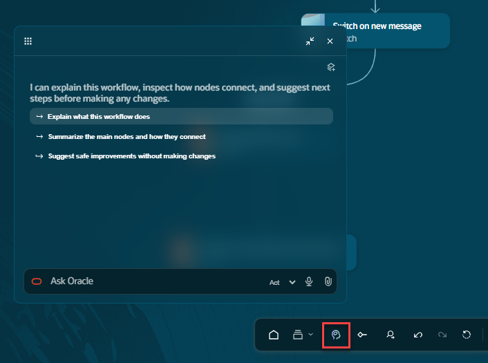
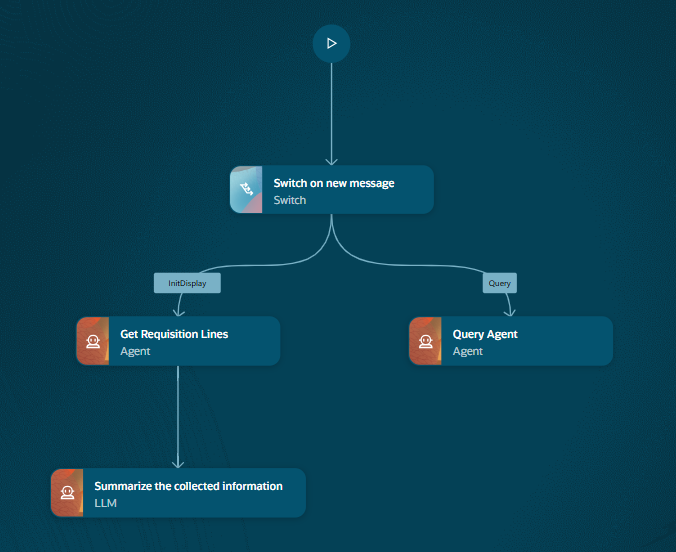
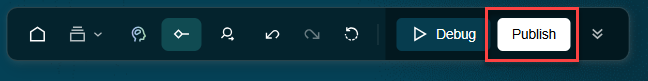
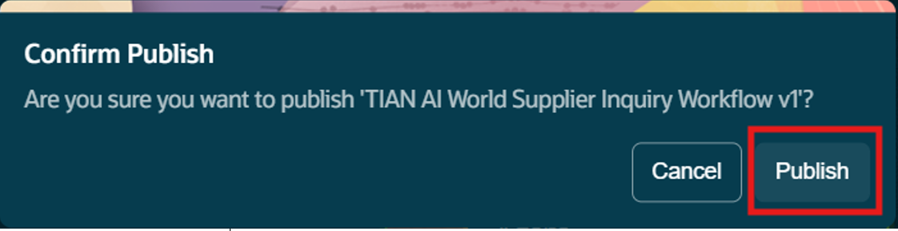
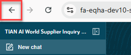
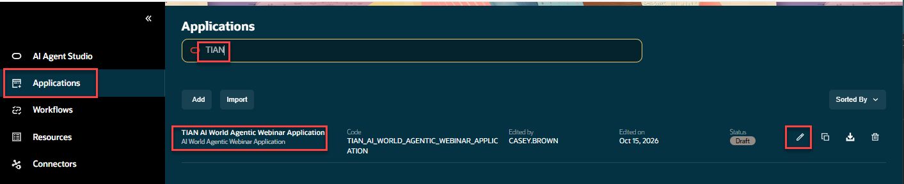
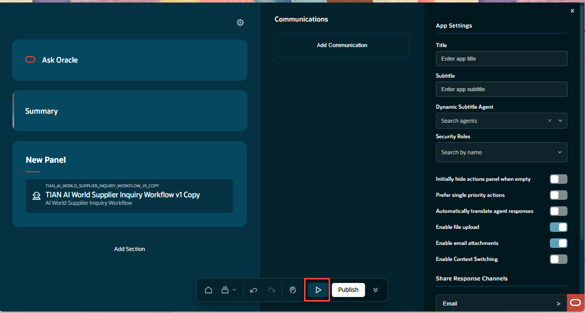
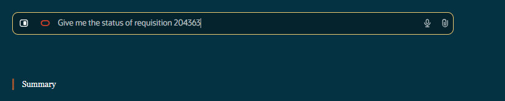
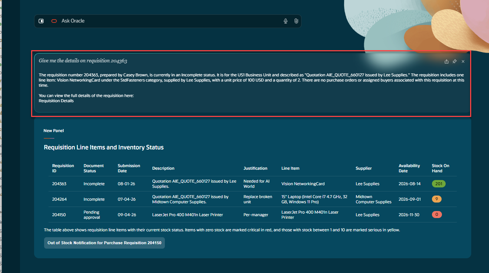

# Extra-credit - Use the Ask Oracle feature to create new nodes in the workflow via prompting

## Introduction

In this extra-credit lab, we will add additional functionality to our workflow using the Ask Oracle feature to extend a workflow without coding or manual configuration.</br>

Estimated Time: 20 minutes

### Objectives

Understand how to leverage the 'Ask Oracle' agentic feature to extend and develop AI Agent artifacts.</br>
Add a second path to the workflow and an additional agent can be called by the agentic application.</br>
**This lab assumes you have completed labs 1 & 2.**

### Usage Notes

   [](include:initial_hints)
## Task 1: Use the Ask Oracle Feature to Add a New Agent Node to the Workflow
***Prerequisite Have the workflow you created in the first three labs open***</br>
   We are going to bring up the the Ask Oracle window so we can post the pre-built prompt included in this lab.</br>
   Click on the **Ask Oracle** icon on the menu at the bottom of the page.
      
   Once the window is open, cut and paste this text into the window.

   ```txt
   <copy>
   Add an Agent node named "Query Agent" with node code QUERY_AGENT. If QUERY_AGENT already exists, configure and connect that node instead of creating a duplicate.
   Configure it to use the existing agent "Purchase Requisition Status Advisor" (agent code ORA_PURCHASE_REQUISITION_STATUS_ADVISOR).
   Set the node's message input to:
   {{$context.$system.$inputMessage}}
   Leave the node's output specification empty so it returns the agent's response.
   Locate the existing switch node that uses this expression:
   {{$context.$app.$OraMessageHint}}
   Add a case named "Query" that matches the value "Query". If the Query case already exists, reuse it instead of creating a duplicate.
   Preserve the switch expression exactly as shown above.
   Connect the switch's Query case to Query Agent. Connect Query Agent's success outcome to End.
   Keep the InitDisplay branch and all its existing nodes and connections unchanged. Preserve all other existing switch cases, nodes, and connections except those explicitly configured above.
   </copy>
   ```
Once the prompt is pasted in, press **Return**.  You may be prompted to continue the processing.

If prompted to continue, reply with  **Yes**.  You will be asked more than once durning this process.

**Durning this process, you will see multiple dialog boxes opened and closed.**</br>
**Do not try to close or change the contents of the windows while the process is running**.

   
   When the process is done you will see a summary of what was created.  At this time you can close the Ask Oracle</br>
   window and any node configuration windows that may be open.
   
   When complete your workflow should look like the image included here  The **Query Agent** node should of been created.
   

2. Publish the Workflow</br>
On the menu at the bottom of the screen, click the **Publish** button.</br>
By publishing the workflow it will make it available to agentic applications.

When prompted to confirm publish, click on the button to publish the workflow.

Once, published, to get back to the home page, click on the back button ***twice***.


3. Re-run the Agentic Application</br>
From AI Agent home page on the left hand pane, select **Applications**. </br>
In the search box on the top of the page, type in the initials you used to create your lab.</br>

Once the application is open, press the **Run** button at the bottom of the screen.

Once the application has ran, you can now provide a query string.</br>
Use the sample question below and paste it into the query box and press **Return**,

   ```txt
   <copy>
   Give me the status of requisition 204363
   </copy>
   ```


The question from the query box will be passed to your workflow via the **Query** path you added in this lab.</br>
The query string will be passed into the **Purchase Requisition Status Advisor** agent, which will query the</br>
Purchase Requisition Business object, obtain the data, format it and return it in the response box.


This completes the the extra-credit lab.
## Summary

Congratulations on completing the extra-credit portion of this lab.</br></br>

You should now have a introductory understanding of the power of the **Ask Oracle** feature.</br>
Also, a basic understanding of how agentic applications interact with agentic workflows, specifically the **InitDisplay** and **Query** paths.

## Acknowledgements
* **Author** - [](var:author)
* **Contributors** - [](var:contributors)
* **Last Updated By/Date** - [](var:last_updated)