# Extra-credit - Use the Ask Oracle feature to create new nodes in the workflow via prompting

## Introduction

In this extra-credit lab, we will add additional functionality to our workflow using the Ask Oracle feature to extend a workflow without coding or manual configuration.</br>

Estimated Time: 20 minutes

### Objectives

Understand how to leverage the 'Ask Oracle' agentic feature to extend and develop AI Agent artifacts.</br>
Add a second path to the workflow and an additional agent can be called by the agentic application.</br>
**This lab assumes you have completed labs 1 & 2.**

### Usage Notes

   [](include:initial_hints)
## Task 1: Reopen your draft version of your workflow
   From the main page, select workflows, search for your initials and select the ***Draft*** version of your workflow.
      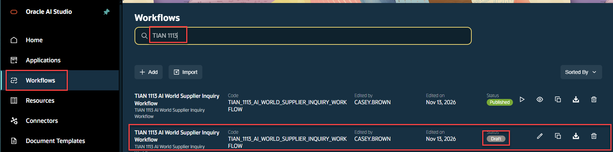
## Task 2: Use the Ask Oracle Feature to Add a New Agent Node to the Workflow
***Prerequisite Have the workflow you created in the first three labs open***</br>
   We are going to bring up the the Ask Oracle window so we can post the pre-built prompt included in this lab.</br>
   Click on the **Ask Oracle** icon on the menu at the bottom of the page.
      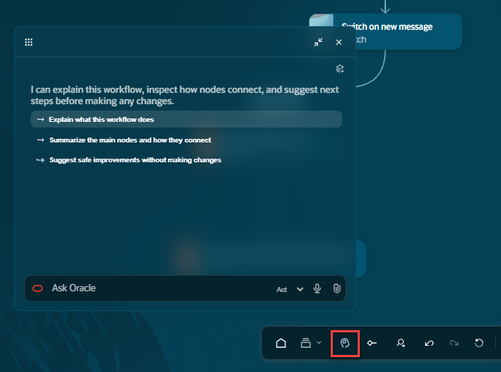
   Once the window is open, cut and paste this text into the window.

   ```txt
   <copy>
Add an Agent node named "Query Agent" with node code QUERY_AGENT.

If QUERY_AGENT already exists, configure and connect that node instead of creating a duplicate. If the existing Query branch already contains an Agent node that calls OTI_PURCHASE_REQUISITION_STATUS_ADVISOR_COPY, reuse that node and rename it "Query Agent" with node code QUERY_AGENT.

Configure the node:
- Agent Type: Reusable
- Family: PRC
- Product: Self Service Procurement
- Agent: "OTI Purchase Requisition Status Advisor Copy"
- Agent code: OTI_PURCHASE_REQUISITION_STATUS_ADVISOR_COPY

Select and resolve the actual existing reusable agent. Do not use the original Purchase Requisition Status Advisor, create another copy, or modify the reusable agent's prompts, tools, topics, or summarization settings.

Set the node's message input to:
{{$context.$system.$inputMessage}}

Leave the node's output specification empty so it returns the agent's response directly.

The OTI agent is already configured to return:
- Factual requisition status text.
- The current approver when applicable.
- Exactly one compact "View requisition" cardWidget when a valid requisition header ID is available.
- A complete destination URL directly in properties.link.action.
- No embedded requisition preview.

Preserve that response exactly. Do not summarize, rewrite, escape, wrap in JSON, or replace its oraInfoDisplay block.

Locate the existing switch node that uses:
{{$context.$app.$OraMessageHint}}

Preserve this switch expression exactly.

Add a case named "Query" that matches the value "Query". If it already exists, reuse it.

Connect:
Switch Query case → QUERY_AGENT → End

Connect Query Agent's success outcome directly to End. Do not place a Code node, LLM node, or other formatting node after Query Agent.

If the Query branch currently routes through BUILD_REQUISITION_QUERY_RESULT, disconnect that Code node from this branch and connect Query Agent directly to End. Preserve the disconnected node and any unrelated connections.

Keep the InitDisplay branch and all its existing nodes, prompts, and connections unchanged. Preserve all other switch cases, nodes, and connections except the Query-path changes explicitly requested above.

Do not change any agentic application configuration, add navigation handlers, create application actions, or add preview panels. Do not publish.

Validate in the workflow debugger using:
"Give me the status of requisition 204150"

Confirm:
- The Query branch calls OTI_PURCHASE_REQUISITION_STATUS_ADVISOR_COPY.
- The final output preserves the agent's factual status and approver.
- The agent's oraInfoDisplay block remains intact.
- The "View requisition" action contains the complete URL with the header ID from the returned requisition record.
- No Code node executes on the Query branch.
- No artifactPreviewWidget or iframe is generated.

The debugger may render the button without executing navigation. Verify the button definition and URL there; actual navigation must be tested in the agentic application.

Reload the draft and confirm that the requested configuration and connections persisted.
   </copy>
   ```
Once the prompt is pasted in, press **Return**.  You may be prompted to continue the processing.
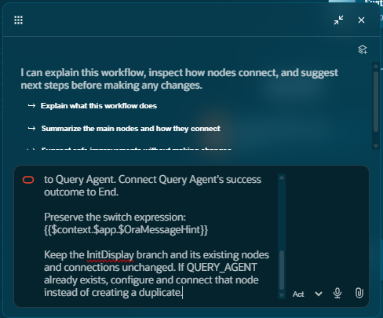
If prompted to continue, reply with  **Yes**.  You will be asked more than once durning this process.

**Durning this process, you will see multiple dialog boxes opened and closed.**</br>
**Do not try to close or change the contents of the windows while the process is running**.

   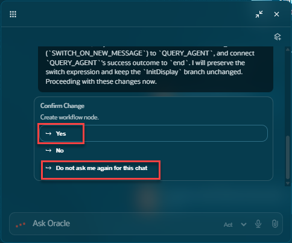
   When the process is done you will see a summary of what was created.  At this time you can close the Ask Oracle</br>
   window and any node configuration windows that may be open.
   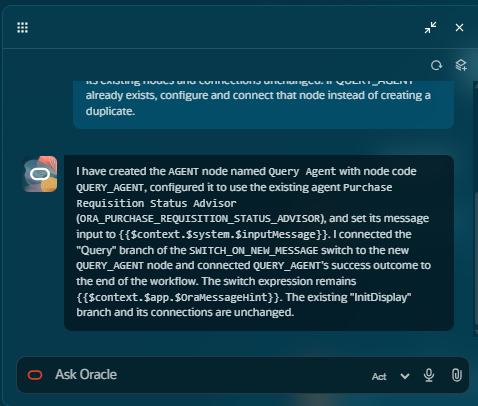
   When complete your workflow should look like the image included here  The **Query Agent** node should of been created.
   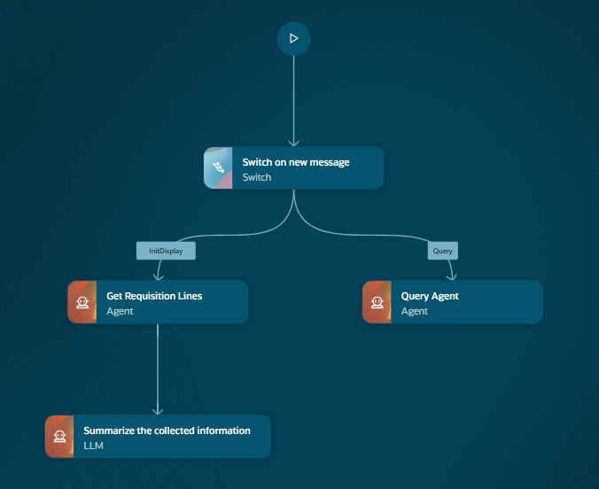

3. Publish the Workflow</br>
On the menu at the bottom of the screen, click the **Publish** button.</br>
By publishing the workflow it will make it available to agentic applications.
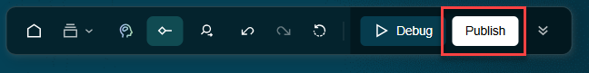
When prompted to confirm publish, click on the button to publish the workflow.

4. Re-run the Agentic Application</br>
From AI Agent home page on the left hand pane, select **Applications**. </br>
In the search box on the top of the page, type in the initials you used to create your lab.</br>
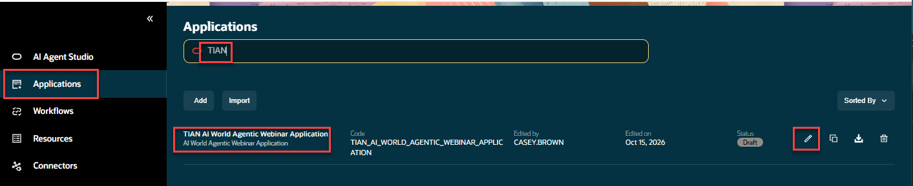
Once the application is open, press the **Run** button at the bottom of the screen.
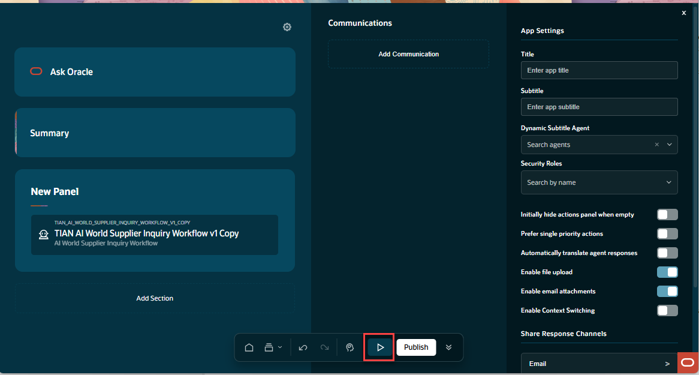
Once the application has ran, you can now provide a query string.</br>
Use the sample question below and paste it into the query box and press **Return**,

   ```txt
   <copy>
   Give me the status of requisition 204363
   </copy>
   ```

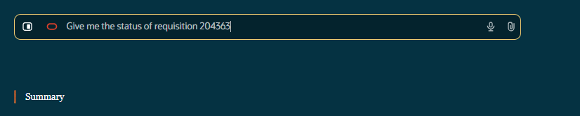
The question from the query box will be passed to your workflow via the **Query** path you added in this lab.</br>
The query string will be passed into the **Purchase Requisition Status Advisor** agent, which will query the</br>
Purchase Requisition Business object, obtain the data, format it and return it in the response box.</br>
You can click on the ***View Requisition*** button and a new browser session will be launched with the requisition page.</br>
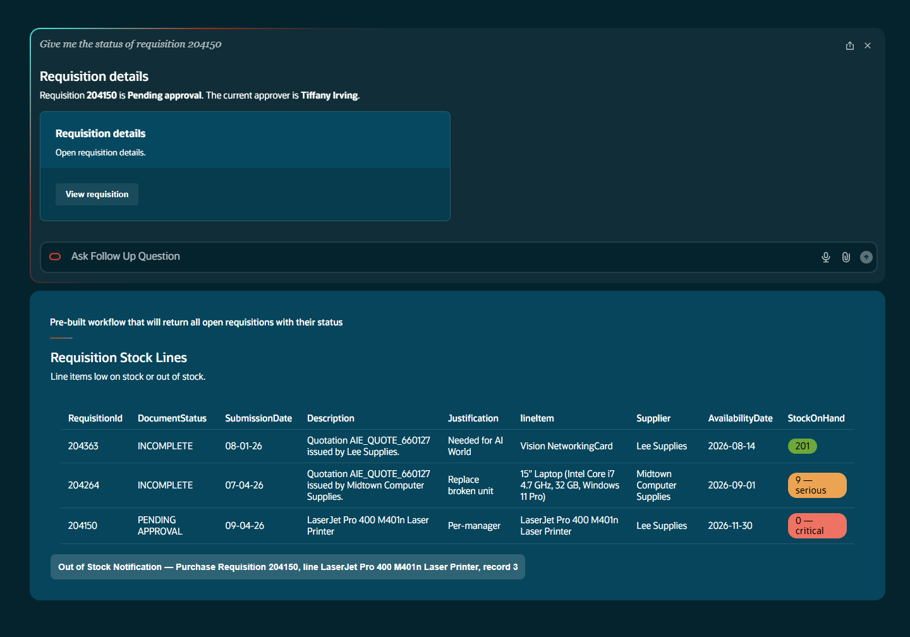

This completes the the extra-credit lab.
## Summary

Congratulations on completing the extra-credit portion of this lab.</br></br>

You should now have a introductory understanding of the power of the **Ask Oracle** feature.</br>
Also, a basic understanding of how agentic applications interact with agentic workflows, specifically the **InitDisplay** and **Query** paths.

## Acknowledgements
* **Author** - [](var:author)
* **Contributors** - [](var:contributors)
* **Last Updated By/Date** - [](var:last_updated)