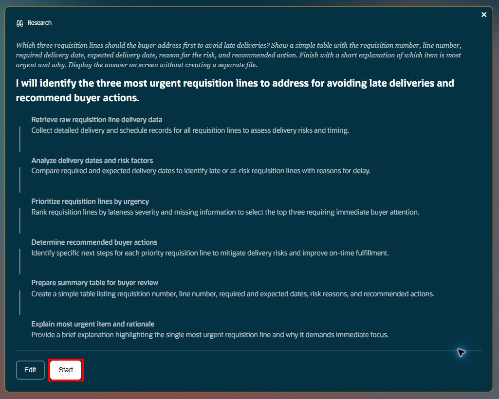
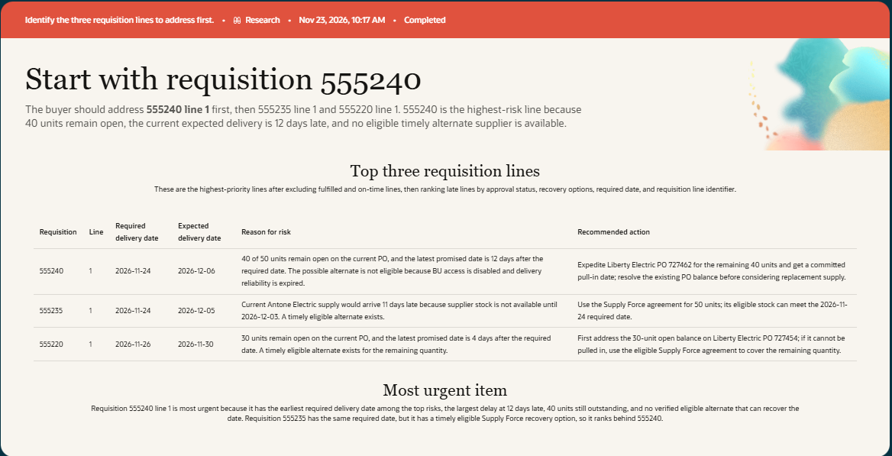

# Extend a Agentic Application with Claw

## Introduction

In this lab you will run the Claw outcome you configured in the previous lab and observe the outcome in deatil. 

Estimated Time: 10 minutes

### Objectives

Execute a Claw research outcome and observe the output.

### Usage Notes

   

## Execute an Outcome   

1. After publishing the application in the previous lab you she be at the applications home page. 

Select **Define an Outcome** button in the upper right hand corner of the screen.

2. Select **OTI AI World Claw Reasoning Find urgent deliveries** 

3. Verify you are in **Research**, confirm the prompt, then select the **Up Arrow** to start the process.

Verify the research window and press **Start**

While it runs, **wait** for Completed and the result. Do not start another copy of the same request. 
The verified first outcome completed in a few minutes.

4. Read the completed outcome

When Completed appears, read the buyer priority summary and the table. The expected delivery column shows the current path before the recommended recovery action is taken.

Requisition and line identify the purchasing need. Required delivery is when it is needed. Expected delivery is a purchase order promise or an estimate calculated under the skill rules. A later expected date indicates a delivery gap.

Read each risk reason with its recommended action. The output is a buyer work list. It does not reserve inventory, approve a requisition, amend a purchase order or send a notification.

5. Understand the buyer priorities

| **Priority** | **Requisition and line** | **Required** | **Expected** | **Late** |
| --- | --- | --- | --- | --- |
| 1 | 555240 line 1 | Nov 24 2026 | Dec 6 2026 | 12 days |
| 2 | 555235 line 1 | Nov 24 2026 | Dec 5 2026 | 11 days |
| 3 | 555220 line 1 | Nov 26 2026 | Nov 30 2026 | 4 days |

555240 line 1 is a Solar Battery Assembly with 40 units still outstanding on PO 727462. The promise is 12 days after the required date. Batt-TechnO has stock, but its business unit access is disabled and its delivery qualification has expired. Claw therefore finds no eligible timely alternative in the returned evidence. Escalate the Liberty Electric promise and agree a recovery path.

555235 line 1 needs 50 NFC Booster IC units and has no purchase order. Antone Electric has no stock until December 3; adding transit and receiving gives December 5. Supply Force has 60 units and meets the documented eligibility checks, giving a planned recovery arrival of November 24. The buyer should confirm that stock and commitment before ordering.

555220 line 1 has 30 Touchscreen units remaining on PO 727454. Its promise is November 30 against a November 26 requirement. Supply Force has enough eligible stock for a planned November 24 arrival. Resolve the original order balance before replacement to avoid ordering twice.

The skill first prioritizes approved late demand without eligible timely recovery. Other late demand follows, sorted by required date and then line ID. This is more than a sort by number of days late.

6. Open the outcome receipt

Scroll below the completed result and select Outcome receipt. Read Understanding of Task to confirm the request and Research mode, then examine Sources and the execution timeline.

*Open Outcome receipt for this completed run.*

The source operation is oti\_ai\_world\_claw\_reasoning\_get\_evidence. It retrieves source records and reports verified coverage. The execution timeline then describes Claw joining records, calculating dates, checking alternatives and ranking the lines. This version does not receive a precomputed priority list from the workflow.

7. Trace the answer to the evidence

Worked for 0:03:11 records the full outcome duration in this verified run. The highlighted Capability time of 6,210 ms is about six seconds for retrieving the evidence. The rest includes orchestration, reasoning and preparing the answer.

Input is {} because the retrieval operation needs no extra search parameters. Output identifies evidence dated November 21, 2026 and 61 records across 14 collections, including eight requisition lines. The receipt summarizes the returned records; it is not a substitute for inspecting source fields when a value needs to be checked.

For the first priority, find the timeline explanation linking 555240 line 1 to its November 24 required date, December 6 outstanding PO promise, 40-unit remaining balance and excluded alternative. Those facts support the 12-day gap and the escalation recommendation.

The exercise is complete when you can explain the first three priorities, identify a buyer action for each and locate the evidence retrieval operation in the receipt. Supplier commitments and stock still require confirmation before the buyer takes action.

8. When done, press the **back** button on your browser to return to the main page. 

   **You have successfully completed the Lab**

## Summary

You should now have a introductory understanding of the basics of agentic applications & Claw in Oracle's AI Agent Studio!

## Acknowledgements
* **Author** - 
* **Contributors** - 
* **Last Updated By/Date** - 