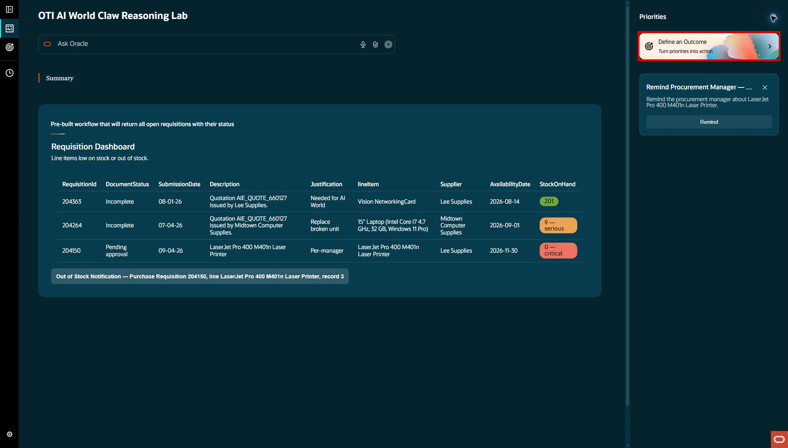
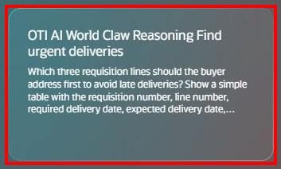
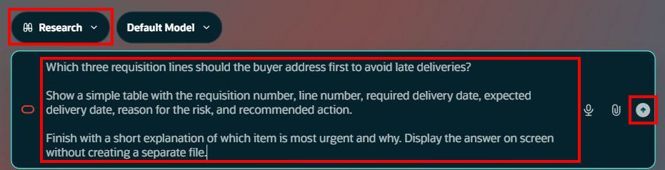
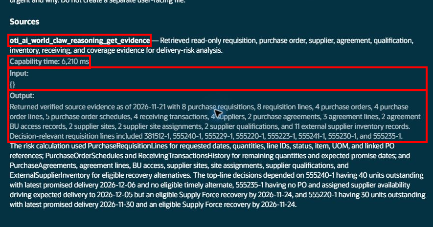

# Extend a Agentic Application with Claw

## Introduction

In this lab you will run the Claw outcome you configured in the previous lab and observe the outcome in deatil. 

Estimated Time: 10 minutes

### Objectives

Execute a Claw research outcome and observe the output.

### Usage Notes

   

## Execute an Outcome

**1. Prepare to execute your outcome** 
After publishing the application in the previous lab you shoulds be at the applications home page. 

Select **Define an Outcome** button in the upper right hand corner of the screen.

**2. Select your outcome** 

Select your defined outcome.  Select **OTI AI World Claw Reasoning Find urgent deliveries** 

**3. Verify what mode you are in** 

Confirm you are in **Research**, confirm the prompt, then select the **Up Arrow** to start the process.

**4. Verification Dialog** 

The verification window lets you review CLAW’s understanding of your request and its proposed plan before the work begins. 
You can check that it is answering the right question and edit the request if needed. Selecting Start tells CLAW to 
proceed with that plan, within the application’s permissions and selected mode, such as Research.

Verify the research window and press **Start**.

While Claw begins, please *wait* for Completed and the result. Do not start another copy of the same request. 
The verified first outcome completed in a few minutes.

**5. Examine the completed outcome**

When the outcome is complete, read the buyer priority summary and the table. The expected delivery column shows the current path before the recommended recovery action is taken.

Requisition and line identify the purchasing need. Required delivery is when it is needed. Expected delivery is a purchase order promise or an estimate calculated under the skill rules. A later expected date indicates a delivery gap.

Read each risk reason with its recommended action. The output is a buyer work list. It does not reserve inventory, approve a requisition, amend a purchase order or send a notification.

**6. Understand the buyer priorities**

| **Priority** | **Requisition and line** | **Required** | **Expected** | **Late** |
| --- | --- | --- | --- | --- |
| 1 | 555240 line 1 | Nov 24 2026 | Dec 6 2026 | 12 days |
| 2 | 555235 line 1 | Nov 24 2026 | Dec 5 2026 | 11 days |
| 3 | 555220 line 1 | Nov 26 2026 | Nov 30 2026 | 4 days |

555240 line 1 is a Solar Battery Assembly with 40 units still outstanding on PO 727462. The promise is 12 days after the required date. Batt-TechnO has stock, but its business unit access is disabled and its delivery qualification has expired. Claw therefore finds no eligible timely alternative in the returned evidence. Escalate the Liberty Electric promise and agree a recovery path.

555235 line 1 needs 50 NFC Booster IC units and has no purchase order. Antone Electric has no stock until December 3; adding transit and receiving gives December 5. Supply Force has 60 units and meets the documented eligibility checks, giving a planned recovery arrival of November 24. The buyer should confirm that stock and commitment before ordering.

555220 line 1 has 30 Touchscreen units remaining on PO 727454. Its promise is November 30 against a November 26 requirement. Supply Force has enough eligible stock for a planned November 24 arrival. Resolve the original order balance before replacement to avoid ordering twice.

The skill first prioritizes approved late demand without eligible timely recovery. Other late demand follows, sorted by required date and then line ID. This is more than a sort by number of days late.

**7. Open the Outcome Receipt**

Scroll to the bottom completed result and select **Outcome Receipt**. 
Read the Understanding of the Task to confirm the request and Research mode, then examine Sources and the execution timeline.

The source operation is *oti\_ai\_world\_claw\_reasoning\_get\_evidence*. It retrieves source records and reports verified coverage. 
The execution timeline then describes Claw joining records, calculating dates, checking alternatives and ranking the lines. 

**8. Trace the answer to the evidence** 

*Capability time: 6,210 ms*, During those six seconds, the workflow read the prepared vectors and returned the procurement 
records. Claw then used those records to connect requisitions to orders and receipts, calculate delivery risks, check supplier alternatives, and prepare the answer.

The text: *Input is {}* tells you the retrieval operation needs no extra search parameters. 
Output identifies evidence dated November 21, 2026 and 61 records across 14 collections, including eight requisition lines. 
The receipt summarizes the returned records.

For the first priority, find the timeline explanation linking 555240 line 1 to its November 24 required date, December 6 outstanding 
PO promise, 40-unit remaining balance and excluded alternative. Those facts support the 12-day gap and the escalation recommendation.

The exercise is complete when you can explain the first three priorities, identify a buyer action for each and locate the evidence 
retrieval operation in the receipt. Supplier commitments and stock still require confirmation before the buyer takes action.

**You have successfully completed the Lab**

## Summary

You should now have a introductory understanding of the basics of agentic applications & Claw in Oracle's AI Agent Studio!

## Acknowledgements
* **Author** - 
* **Contributors** - 
* **Last Updated By/Date** - 