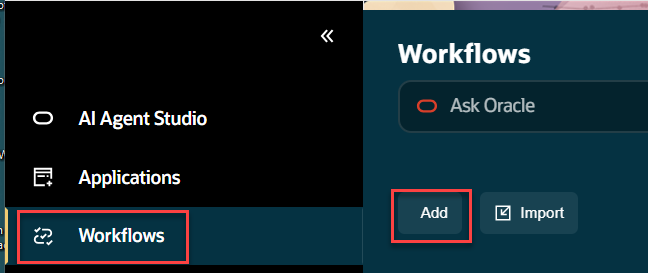
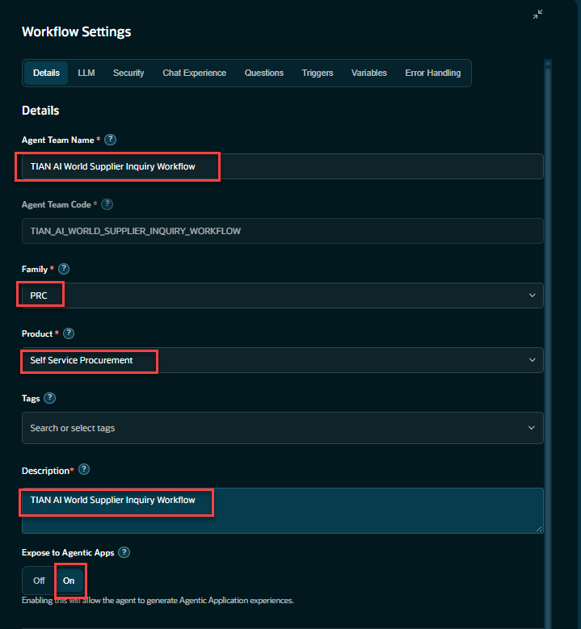

# Create an Agentic Workflow

## Introduction

In this lab will create an agentic workflow capable of being used in an agentic application we will create in the next lab.  This will include the workflow configuration, creating the necessary nodes and configuring them.

Estimated Time: 30 minutes

### Objectives

Get a basic understanding of workflows in AI Agent studio.

### Usage Notes

   [](include:initial_hints)

## Task 1: Login and Navigate to the AI Agent Studio Landing Page
1. First you will log in and navigate to AI Agent Studio.
Login to the lab environment using the credentials provided.  Navigate to the AI Agent Studio tile and click on it.</br>
2. Optionally from the menu button in the upper left hand corner of the browser window, navigate to the **Tools** tab and Click on the tile for **AI Agent Studio**:


3. Clicking on the AI Agent Studio tile will take you to the AI Agent Studio landing page.

On the landing page you can access all of the features and options in AI Agent Studio.</br></br>


## Task 2: Create and Configure the Workflow
1. We are going to create a new workflow, so click on **Workflows** menu option.  Then click on **Add**.</br>


2. Make sure to use ***YOUR INITIALS*** when naming the template.<br/>
For the Agent Team Name include: **AI World Supplier Inquiry Workflow** after your initials.</br>
You can copy the workflow name by copying it here.
   ```txt
   <copy>
   AI World Supplier Inquiry Workflow
   </copy>
   ```
Continue with the configuration using the values here.</br>
Family: **PRC**</br>
Product: **Self Service Procurement**</br>
Description: **Copy the title of the workflow**</br>
Expose to Agentic Apps: **On**</br>


## Summary
You should now have a brief introductory understanding of creating a workflow.<br/>
In the next lab we will populate our workflow to get ready for it to be installed in an agentic application.

[Proceed to the next lab](#next)

## Acknowledgements
* **Author** - [](var:author)
* **Contributors** - [](var:contributors)
* **Last Updated By/Date** - [](var:last_updated)