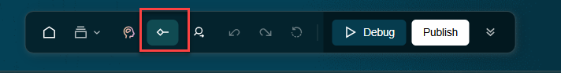
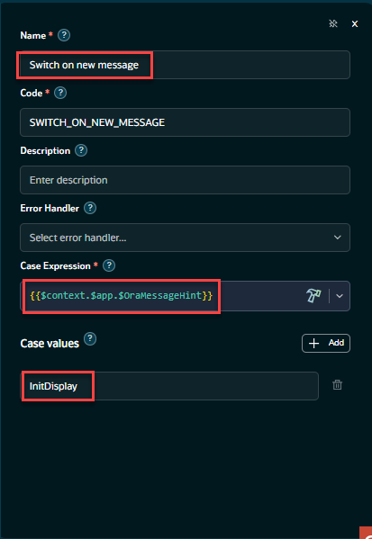
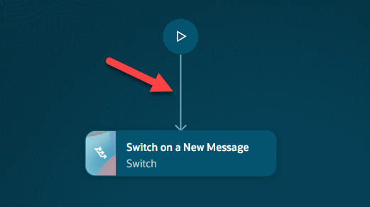
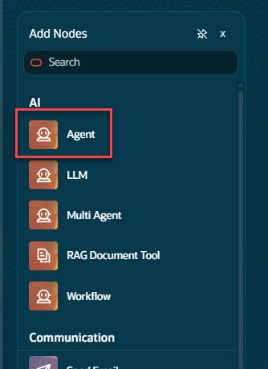
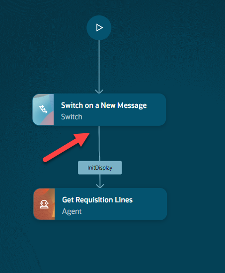
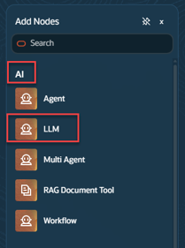
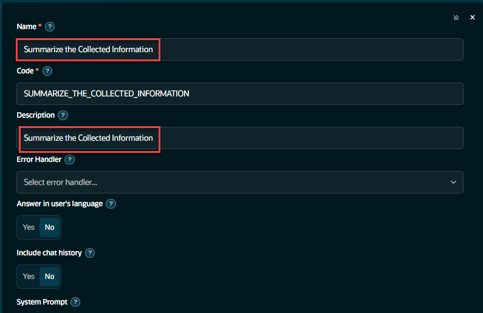
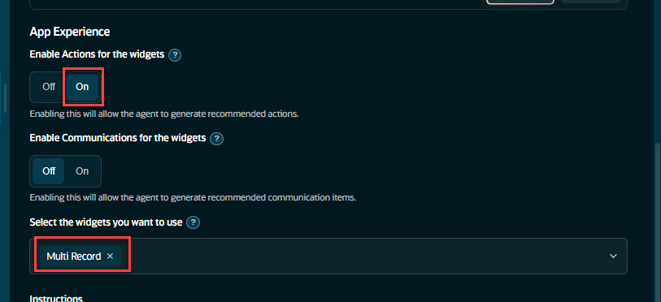
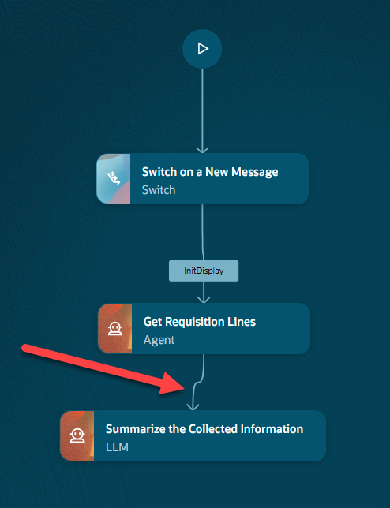

# Configure Your Workflow

## Introduction

In this lab will will continue the work started in Lab #1.  We will populate the workflow and get it ready to be published.

Estimated Time: 30 minutes

### Objectives

Understand the structure of a pre-built workflow template and agent tools in AI Agent Studio.

### Usage Notes

   [](include:initial_hints)

## Task 1: Add the Switch Node to the Workflow
We will add the first node to the workflow.  The switch node will direct incoming messages from the agentic</br>
application to the correct branch in the workflow.</br>
At the bottom of the page, from the menu bar, click on the Component Pallette Button</br>

The Node pallette should appear on the left side of the screen.  Scroll down to **Workflow Control** and click on the **Switch** node.</br>


1. Configure the switch node.</br>
Name: **Switch on a New Message**</br>
Description: **Switch on a New Message**</br>
Case Expression: ***{{$context.$app.$OraMessageHint}}***</br>

You can copy this value here and paste it into the **Case Value** field.
   ```txt
   <copy>
   {{$context.$app.$OraMessageHint}}
   </copy>
   ```
Add the case Value: **InitDisplay**.  When the agentic app loads our workflow, this is the first value passed in when the workflow is loaded.</br></br>
Once you have completed this part of the configuration, you are ready to connect this node to the start icon.

2. Connect the Switch Node to the start of the workflow


## Task 2: Create the Agent Node
1. Select the Agent from the AI section of the Component Pallette


2. Configure the Agent Node Part #1</br>
Make sure the name of this node is:  **Get Requisition Lines**</br>

You can copy the value for the node name here.
   ```txt
   <copy>
   Get Requisition Lines
   </copy>
   ```

Continue configuring the agent node with the values listed here.</br>

Agent Type: **Reuseable**</br>
Family: **PRC**</br>
Product: **Self Service Procurement**</br>
From the drop down list select the agent.
Agent: **AI World Retrieve All Requisitions**</br>


3. Continue to configure the Agent Node</br></br>
Scroll down the Agent Node configuration dialog to include the rest of the configuration.</br>
Enable Actions for the widgets:  **On**
Select the widgets you want to use: **Multi Record**</br>


4.	Connect Agent to Switch Node
Click on the switch node, the **InitDisplay** case value will be present. Connect the agent node to this case value.</br>


## Task 3: Create and Configure the LLM Node
In this section we will create and configure an LLM node that will output the information produced by the agent node. This will be passed on to the frame in the agentic application.

1.	Select the LLM node from the Component Palette under the AI section.

   
2. Configure the LLM Node</br>
    Name:  **Summarize the Collected Information**</br>
    Description: **Summarize the Collected Information**</br>

   
   Scroll down to the **User Prompt** box. Cut and paste the new prompt include here.</br>
   
3. Click **Copy** in the box below to copy the new prompt.
   ```txt
   <copy>
   DASHBOARD DATA (untrusted):
   Use this as input.  There will be multiple records.
   Each record should be part of the output.  no exceptions.

   Use the variable {{$context.$nodes.GET_REQUISITION_LINES.$output}} for the output data.
   Do not make up data or use data from another source.

   Generate exactly one oraInfoDisplay with patternId multiRecordWidget.
   - Subtitle: 'Line items low on stock of out-of-stock.'
   - Columns: RequisitionId, DocumentStatus, SubmissionDate, Description, Justification, lineItem, Supplier, AvailabilityDate, StockOnHand.

   - IF stock on hand = zero, mark record as critical and mark the stock on hand color red.
   - IF stock on hand >= 1 but <= 10, mark record as serious and mark the stock on hand color yellow.
   - All other records stock on hand should be color green.

   if StockOnHand = 0 then Return EXACTLY 1 <oraInsight> block - using the current row of data.
   <oraInsight>
   {
    "title": "Remind Procurement Manager",
    "shortDescription": "Remind the procurement manager on " and Negotiation Name or Description,
    "actionText": "Remind",
    "followUpCommand": "ora.Invoke",
    "priority": true
   }
   </oraInsight>

   Do not invent records or facts.
   Do not render cardWidget.
   </copy>
   ```


4. Finish the configuration of the LLM Node</br>
   Set these remaining fields to finish the configuration of the LLM Node.</br></br>
   Enable Actions for the widgets:  **On**<br>
   Select the widgets you want to use: **MultiRecord**</br>
   

5. Connect the LLM Node to the Workflow


Click on the bottom center of the agent node.  You will see a black dot and a '+' sign.  Drag the connector from the bottom of the agent node to the top of the LLM node.</br>

6. Publish the Workflow
On the menu at the bottom of the screen, click the **Publish** button.</br>
By publishing the workflow it will make it available to agentic applications.


This completes the second lab.

## Summary
You should now have a brief introductory understanding of some the tools and prompts used in this sample workflow.<br/>
In the next lab we will create an agentic application with our workflow and run it.

[Proceed to the next lab](#next)

## Acknowledgements
* **Author** - [](var:author)
* **Contributors** - [](var:contributors)
* **Last Updated By/Date** - [](var:last_updated)