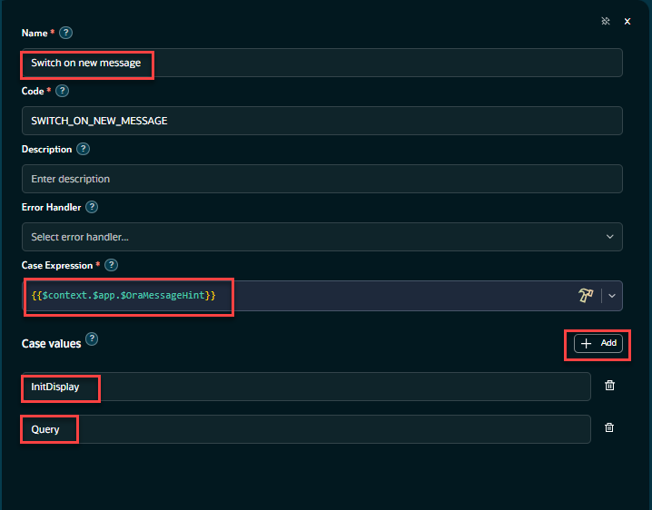
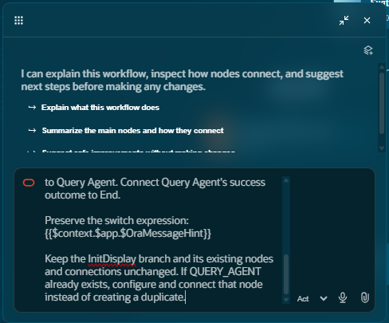
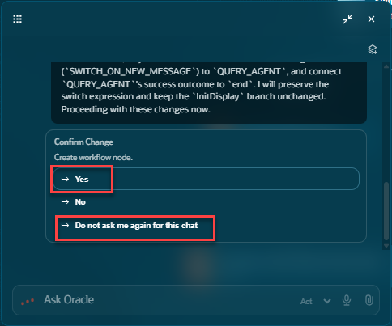
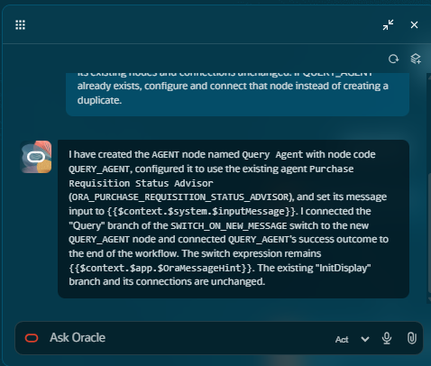
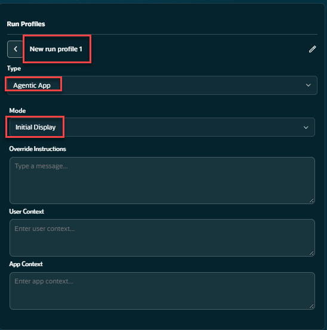
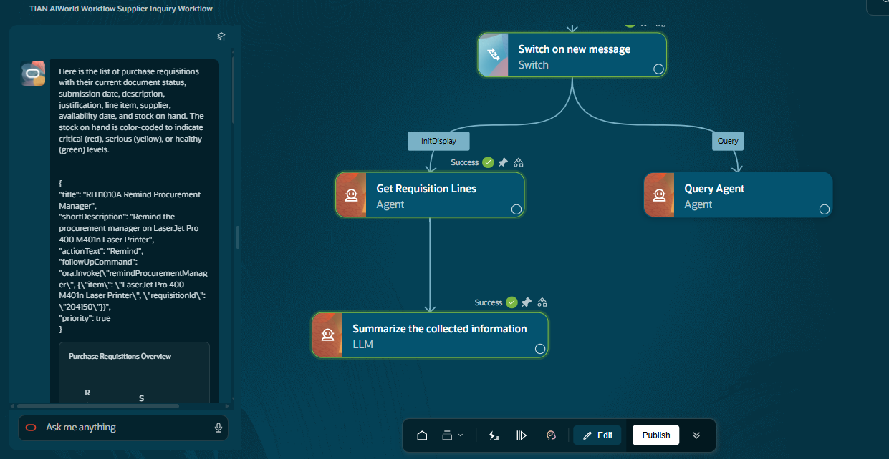

# Extra-credit - Use the Ask Oracle feature to create new nodes in the workflow via prompting

## Introduction

In this extra-credit lab, we will add additional functionality to our workflow using the agentic-brain, configure a debug profile and test the workflow prior to adding it to an agentic application.

Estimated Time: 20 minutes

### Objectives

Understand how to leverage the 'Ask Oracle' agentic feature to extend and develop AI Agent artifacts.
Add a second path to the workflow that can be called by the agentic application.
Understand how to setup a debug profile and run an agentic application in debug mode.
This lab assumes you have completed labs 1 & 2.

### Usage Notes

   [](include:initial_hints)

## Task 1: Add an Additional Branch to the Switch Node
We need to add a 2nd branch to the workflow to accommodate a 2nd path in the workflow that will support queries from the agentic application.  Attached to this new path will be one of Oracle's pre-built agents. The agent - **Purchase Requisition Status Advisor** will answer queries related to purchase requisitions asked by the user.

Add the additional case value **Query** to the switch node.
Click on the Switch node **Switch on new message**, its configuration dialog box will open up.
Under the **Case Values** add a second case value of **Query**
   

## Task 2: Use the Ask Oracle feature to add a new agent node to the workflow
We are going to bring the the Ask Oracle window so we can post the pre-built prompt included in this lab.
Click on the **Ask Oracle** icon on the menu at the bottom of the page.
   
Once the window is open, cut and paste this text into the window.

   ```txt
   <copy>
   Add an Agent node named "Query Agent" with node code QUERY_AGENT.

   Configure it to use the existing agent "Purchase Requisition Status Advisor" (agent code ORA_PURCHASE_REQUISITION_STATUS_ADVISOR).

   Set the node's message input to:
   {{$context.$system.$inputMessage}}

   Leave the node's output specification empty so it returns the agent's response.

   After creating and configuring the node, connect the existing Query branch of the "Switch on new message" switch (SWITCH_ON_NEW_MESSAGE) to Query Agent. Connect Query Agent's success outcome to End.

   Preserve the switch expression:
   {{$context.$app.$OraMessageHint}}

   Keep the InitDisplay branch and its existing nodes and connections unchanged. If QUERY_AGENT already exists, configure and connect that node instead of creating a duplicate.
   </copy>
   ```
Once the prompt is pasted in, press return.  You may be prompted to continue the processing.
   
If prompted to continue, reply with  **Yes**.  You will be asked more than once durning this process.

**Durning this process, you will see multiple-dialog boxes opened and closed.**</br>
**Do not try to close or change the contents of the windows while the process is running**.

   
   When the process is done you will see a summary of what was created.  At this time you can close the Ask Oracle</br>
   window and any node configuration windows that may be open (there should be only one configuration window for the new node).
   
   When complete your workflow should look like the image included here  The **Query Agent** node should of been created.
   

## Task 3: Configure a run-time profile and test
With this task we will configure a run-time profile and test the agent.
Click on the **Debug** button on the menu at the bottom of the page.
   
   Click on the **Run Profiles** icon on the bottom of the page.
   
   When the run profiles window open, click on the **Create new profile** button.
   
   Provide the following values:</br>
   Profile name:  ***Use the default name provided***</br>
   Type:  select **Agentic App**</br>
   Mode: select **Initial Display**</br>
   This is the message that will be passed into the workflow.</br>
   With this set to **Initial Display** the workflow will take the **InitDisplay** path in the workflow.
   

   When you have completed filling in the details click on the create profile icon again.</br>
   Once the window is closed, click on the **Create New Profile** button again and click on your profile.</br>
   The **run icon** will appear.  Click it and start debugging.
   
   The workflow should begin to run at this point.
   

## Task 4: Examine the Debugging Output
We will get to this later...

## Task 5: Publish the workflow
   Once you have completed examining the debugging output you can publish the workflow. This concludes this lab.
   

This completes the the extra-credit lab.

## Summary
You should now have a brief introductory understanding of the power of the **Ask Oracle** feature as well as how to configure debugging for a agentic workflow.
In the next lab we will create an agentic application with our workflow and run it.

[Proceed to the next lab](#next)

## Acknowledgements
* **Author** - [](var:author)
* **Contributors** - [](var:contributors)
* **Last Updated By/Date** - [](var:last_updated)