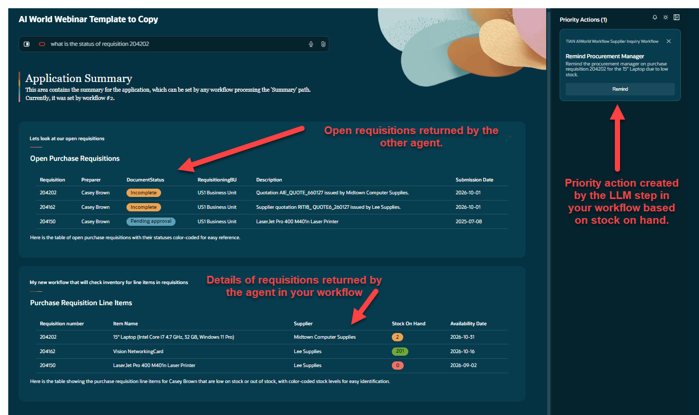

# Creating an Agentic Application and Test it

## Introduction

In this section we will take the workflow that we created in the two previous labs and add it to an agentic application. 
Estimated Time: 15 minutes

### Objectives

Understand the how to create a basic agent application. 

### Usage Notes

   

## Task 1: Create the Agentic Application
1. From AI Agent home page on the left hand pane, select **Applications**.  When the application window, opens, select **Add**. 

## Task 2: Run the Agentic Application

   **You have successfully completed the Lab**

## Summary

You should now have a introductory understanding of the basics of agentic applications in Oracle's AI Agent Studio!

## Acknowledgements
* **Author** - 
* **Contributors** - 
* **Last Updated By/Date** - 