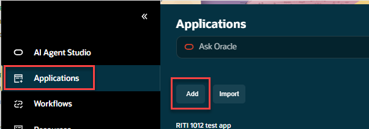
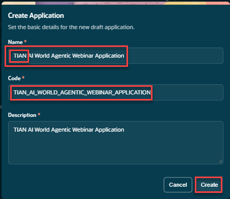
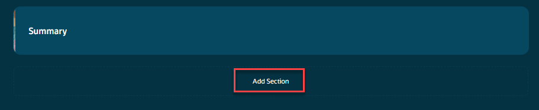
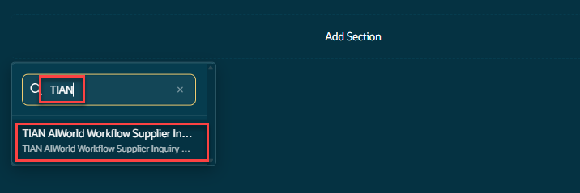
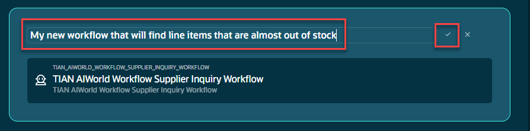
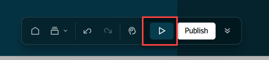
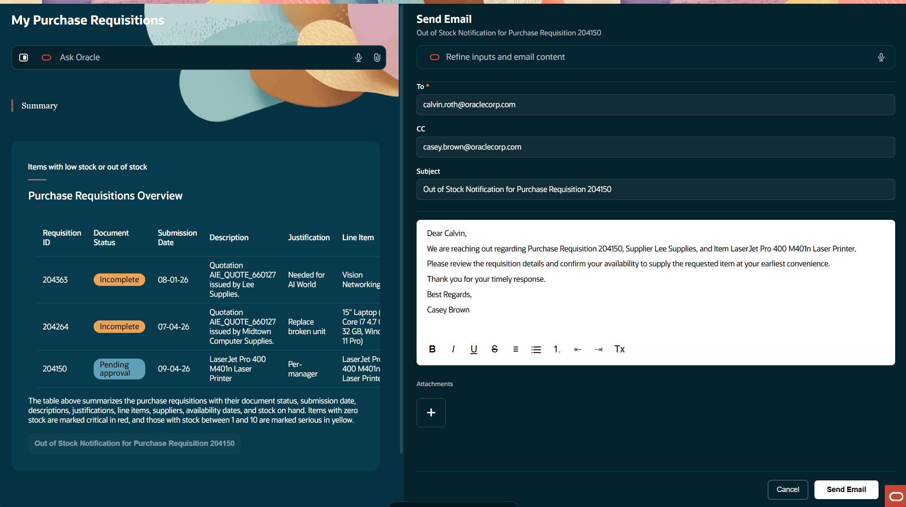

# Creating an Agentic Application and Test it

## Introduction

In this section we will take the workflow that we created in the two previous labs and add it to an agentic application.
Estimated Time: 15 minutes

### Objectives

Understand the how to create a basic agent application.

### Usage Notes

   [](include:initial_hints)

## Task 1: Create the Agentic Application
1. From AI Agent home page on the left hand pane, select **Applications**.  When the application window, opens, select **Add**.</br>

For the name of the applications use:  ***Your Initials*** and include **AI World Agentic Webinar Application**.</br>
You can copy the workflow name by copying it here.
   ```txt
   <copy>
   AI World Agentic Webinar Application
   </copy>
   ```
Description: ***Copy the application name***

2. Add a new section to the application and add your workflow
We will now add a new section to the agentic application and add our published workflow to it.</br>
Click on **Add Section**.

Search for your workflow to add to the section.  Use the initials that you used to locate your workflow.</br>
If your workflow doesn’t show up you may need to check to make sure you published it or you didn’t set the **Agentic Apps** switch when creating it.</br>

3. Name the Panel</br>
Click on the default panel name.  Then click on the Pencil icon to the right.</br>
You can use the name provided here or give it a name of your own.</br>
Name: **Pre-built workflow that will return all open requisitions with their status**</br>
When you have entered the panel name, clicl on the **Check box** to the right of the panel.


## Task 2: Run the Agentic Application
1. Run the application
To run the application, click on the **Play** button on the menu at the bottom of the page.<br>


2. Observe the output
**Add text here**


   **You have successfully completed the Lab**

## Summary

You should now have a introductory understanding of the basics of agentic applications in Oracle's AI Agent Studio!

## Acknowledgements
* **Author** - [](var:author)
* **Contributors** - [](var:contributors)
* **Last Updated By/Date** - [](var:last_updated)