# Build the TIAN2 Purchase Requisition Supervisor Agent

## Introduction

In this lab we will copy the provided **Purchase Requisition Status Advisor TIAN3** workflow and extend it into a simple agent team that answers purchase requisition questions, opens the requisition record, and checks supplier availability.

Estimated Time: 30 minutes

### Objectives

In this lab, you will:
* Copy the provided Purchase Requisition Status Advisor TIAN3 workflow.
* Add one supervisor and one Supplier Inquiry worker.
* Use the provided purchase requisition and supplier tools.
* Try the requisition status, requisition link, and supplier availability experiences.
* Publish your own completed workflow.

### Usage Notes

   [](include:initial_hints)

## Task 1: Locate and copy the Purchase Requisition Status Advisor TIAN3 workflow

1. Sign in to the lab environment using the user assigned to you.

2. Go to the **Tools** tab and select **AI Agent Studio**.

3. Select **Workflows** from the left navigation.

4. Enter **TIAN3** in the search box.

5. Locate **Purchase Requisition Status Advisor TIAN3** and select the **Duplicate** icon on that row.

   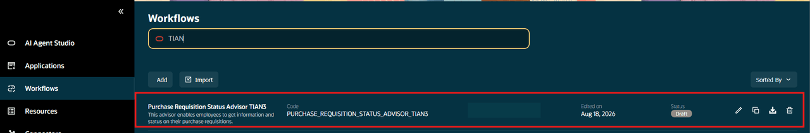

6. Add ***YOUR INITIAL CODE*** to the workflow name and code, then select **Continue**.

7. Select **Save and Close**. Search for your initials, open your new workflow, and confirm its status is **Draft**.

   > ***STATUS CHECKPOINT*** <br/>
   > Confirm that the Status column for your uniquely named workflow shows **Draft** before you continue.

   **You have successfully completed Task 1!**

## Task 2: Review the provided Purchase Requisition Status Advisor

1. Open your workflow copy and select the existing **Purchase Requisition Status Advisor Agent** node.

2. Confirm that the agent is set to **Reusable** and that the provided Purchase Requisition Status Advisor is selected.

   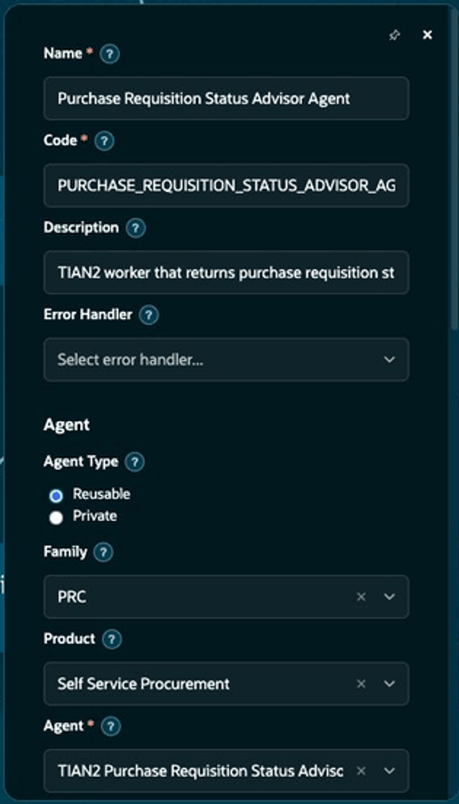

3. Scroll to **Tools** and confirm that the agent includes **View Purchase Requisition Details** and **Requisition Status Advisor**.

4. Leave the provided agent and tools unchanged.

   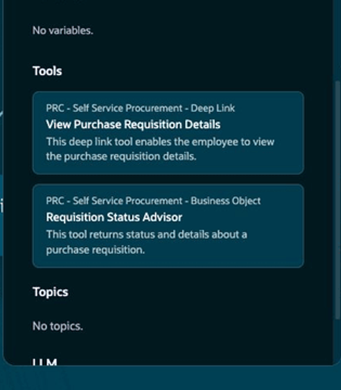

   > ***STATUS CHECKPOINT*** <br/>
   > Confirm that the status advisor and both provided tools are visible in your workflow copy.

   **You have successfully completed Task 2!**

## Task 3: Add and configure the supervisor

1. Select **Show Component Palette** on the bottom toolbar.

2. Under **AI**, drag **Multi Agent** to the canvas between **Start** and the existing status advisor.

   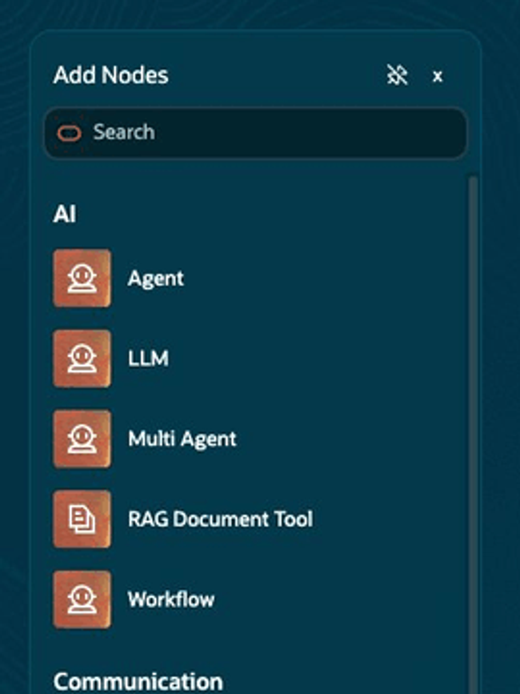

3. Enter the following values:
   * **Name:** TIAN2 Purchase Requisition Supervisor Agent - ***YOUR INITIAL CODE***
   * **Model:** GPT-5 Mini (Premium)
   * **Reasoning:** Medium
   * **Maximum Interactions:** 5
   * **Chat History:** On

4. In **Instructions**, paste the following text:

    ```txt
    <copy>
    You supervise exactly two workers.
    Route requisition status, details, approver, buyer, and requisition-link requests to Purchase Requisition Status Advisor Agent.
    Route supplier, inventory, stock, availability, and backorder requests to TIAN2 Supplier Inquiry MCP Agent.
    For a follow-up question, reuse the supplier and item description from the most recent requisition details.
    Route each request to only one worker. Preserve the clickable requisition link returned by the status advisor.
    </copy>
    ```

   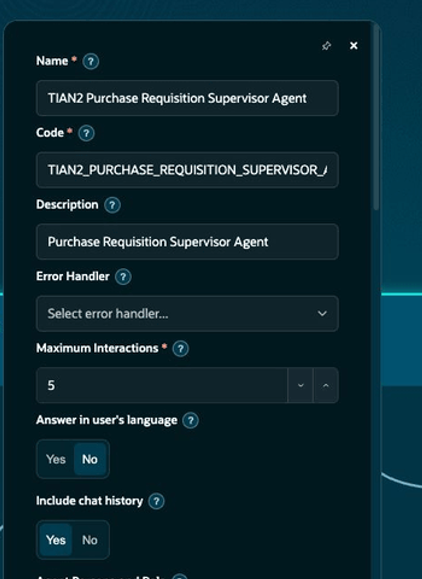

   > ***STATUS CHECKPOINT*** <br/>
   > Confirm that one Multi Agent supervisor is on the canvas and its instructions route requests to the correct worker.

   **You have successfully completed Task 3!**

## Task 4: Add the Supplier Inquiry worker

1. Drag a second **Agent** below the supervisor.

2. Set **Agent Type** to **Private**.

3. Enter **TIAN2 Supplier Inquiry MCP Agent - YOUR INITIAL CODE** as the name.

4. Turn **Chat History** on and set **Maximum Interactions** to **3**.

5. In the worker instructions, paste the following text:

    ```txt
    <copy>
    Answer supplier inventory and item-availability questions only.
    Use the AIE MCP Supplier tool once with the exact supplier and item description from the request or recent conversation.
    If either value is missing, ask the user for it.
    Start with Yes only when stock is available to ship. Otherwise start with No and state the status, stock on hand, and availability date.
    Keep the answer short, informal, and easy to scan.
    </copy>
    ```

   > ***STATUS CHECKPOINT*** <br/>
   > Confirm that the Supplier Inquiry worker is Private, Chat History is on, and the answer begins with a clear Yes or No.

   **You have successfully completed Task 4!**

## Task 5: Add the provided supplier tool

1. In the **TIAN2 Supplier Inquiry MCP Agent** property sheet, scroll to **Tools**.

2. Search for **AIE MCP Supplier**.

3. Select the plus sign, then select **Add**.

4. Confirm that **AIE MCP Supplier** appears on the worker. Do not change the shared tool.

   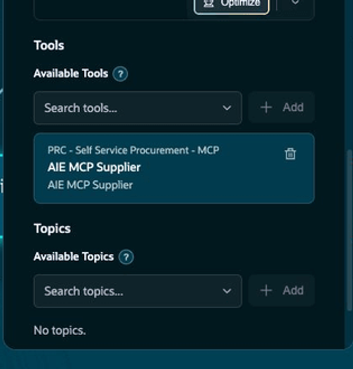

   > ***STATUS CHECKPOINT*** <br/>
   > Confirm that the worker shows one AIE MCP Supplier tool and no additional supplier tool.

   **You have successfully completed Task 5!**

## Task 6: Connect the agent team and add starter questions

1. Remove the original connector from **Start** to the status advisor, if it is still present.

2. Connect **Start** to the supervisor.

3. Connect the supervisor to the **Purchase Requisition Status Advisor Agent**.

4. Connect the supervisor to the **TIAN2 Supplier Inquiry MCP Agent**.

5. Connect both workers to **End**.

6. Select **Workflow Settings**, then select **Questions**.

7. Enter these starter questions:
   * **Question 1:** What is the status and the details for requisition 204150?
   * **Question 2:** Does Lee Supplies have the LaserJet Pro 400 M401n Laser Printer in stock?

   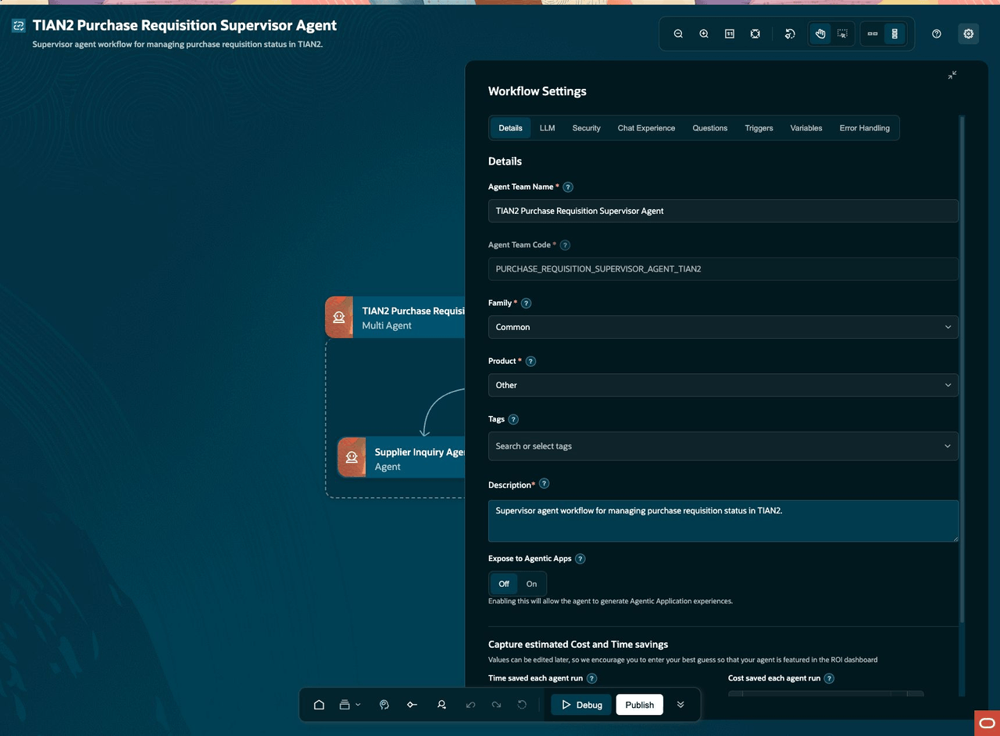

8. Close Workflow Settings and select **Zoom to fit**.

   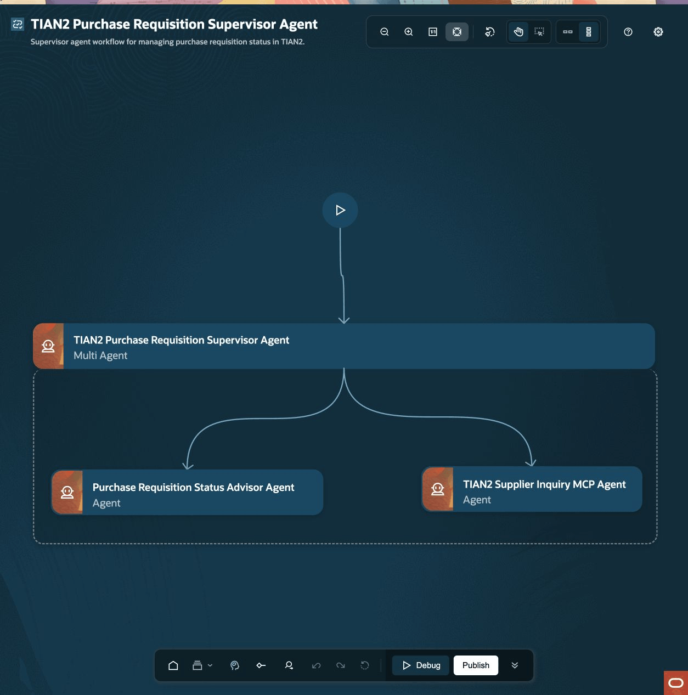

   > ***STATUS CHECKPOINT*** <br/>
   > Confirm that the canvas shows one supervisor, two workers, Start, and End, with both starter questions saved.

   **You have successfully completed Task 6!**

## Task 7: Try the requisition status and link experience

1. Select **Debug** on the bottom toolbar.

2. Start a new conversation and enter:

    ```txt
    <copy>What is the status and the details for requisition 204150?</copy>
    ```

3. Confirm that the request is handled by **Purchase Requisition Status Advisor Agent**.

   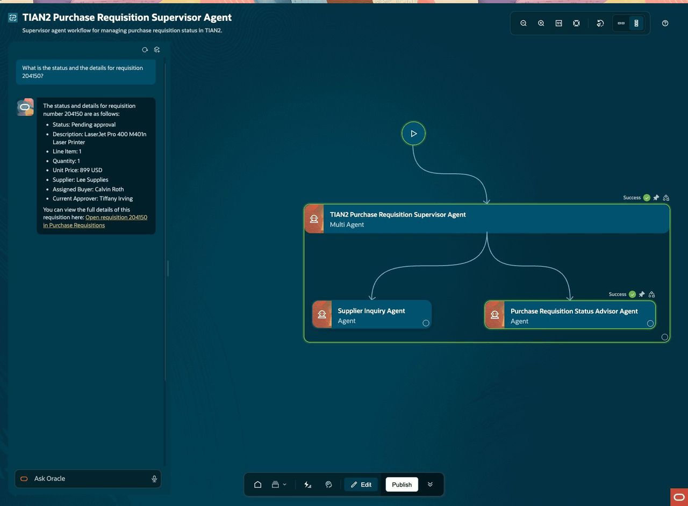

4. Confirm that the answer includes the requisition status, item, quantity, unit price, supplier, buyer, and current approver.

5. Select the descriptive **Open requisition 204150 in Purchase Requisitions** link and confirm that the requisition details page opens.

   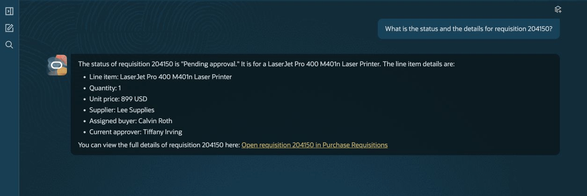

   > ***STATUS CHECKPOINT*** <br/>
   > Confirm that requisition 204150 is Pending approval and the clickable link opens the requisition details page.

   **You have successfully completed Task 7!**

## Task 8: Try the supplier availability experience

1. In the same conversation, enter:

    ```txt
    <copy>Does the supplier have this item in stock?</copy>
    ```

2. Confirm that the request is handled by **TIAN2 Supplier Inquiry MCP Agent**.

3. Confirm that the answer begins with **No** and clearly states that Lee Supplies cannot ship the LaserJet Pro 400 M401n Laser Printer right now.

4. Confirm that the answer also shows **Backordered**, stock on hand of **0**, and the availability date on record.

5. Start a new conversation and try the complete question:

    ```txt
    <copy>Does Lee Supplies have the LaserJet Pro 400 M401n Laser Printer in stock?</copy>
    ```

   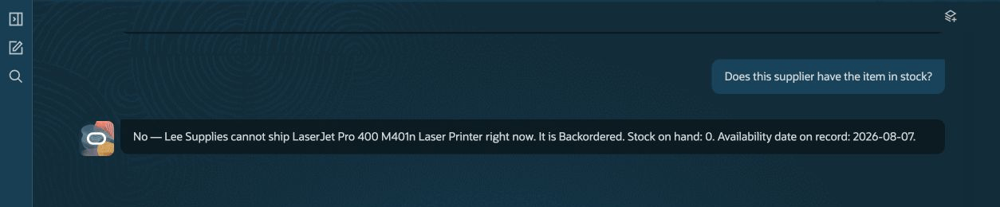

   > ***STATUS CHECKPOINT*** <br/>
   > Confirm that both the follow-up and complete question return the same single-item availability answer.

   **You have successfully completed Task 8!**

## Task 9: Publish and try your completed workflow

1. Return to **Edit** mode and confirm that your canvas still shows one supervisor and two workers.

2. Select **Publish** and wait for the published version to complete.

3. Open your published workflow in Ask Oracle.

4. Ask the requisition status question and select the requisition link.

5. Ask the supplier follow-up question and confirm that the answer begins with a clear Yes or No.

   > ***STATUS CHECKPOINT*** <br/>
   > Confirm that both customer scenarios work in your published workflow and that the published canvas matches your completed draft.

   **Congratulations! You have successfully completed the TIAN2 Purchase Requisition Supervisor Agent lab!**

## Summary

You copied the provided Purchase Requisition Status Advisor TIAN3 workflow and extended it into a three-agent TIAN2 experience. Your supervisor now routes requisition questions to the provided status advisor and supplier questions to a focused Supplier Inquiry worker that uses the provided supplier tool.

[Proceed to the next lab](#next)

## Acknowledgements
* **Author** - [](var:author)
* **Contributors** - [](var:contributors)
* **Last Updated By/Date** - [](var:last_updated)
