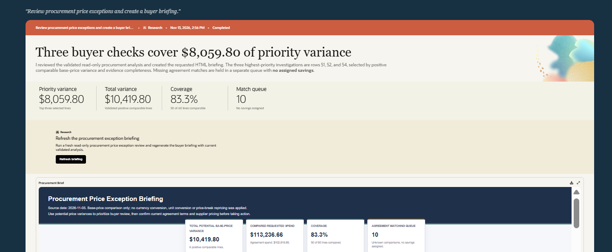

# Chapter 1 Introduction

## Build Your First Oracle Fusion Claw Application - Procurement Spotlight

Source date: November 19, 2026.

This demo introduces Oracle Fusion Claw through a procurement price-review use case. 
Students create an agentic application using existing workflows and a prepared procurement dataset 
The application displays a snapshot of priority price variances, answers procurement questions through Ask Oracle, 
and uses Claw to produce an HTML buyer briefing with investigation priorities, evidence gaps, and recommended follow-up steps. 

## Chapters

1. [Introduction](../01-introduction/README.md)
2. [Creating the agentic application](../02-create-agentic-application/create_application.md)
3. [Performing the Claw configuration](../03-configure-claw/configure_claw.md)
4. [Running the application](../04-run-application/generate_outcome.md)
