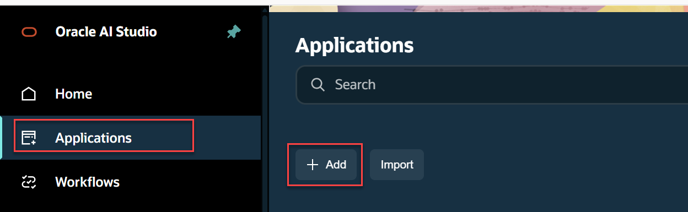
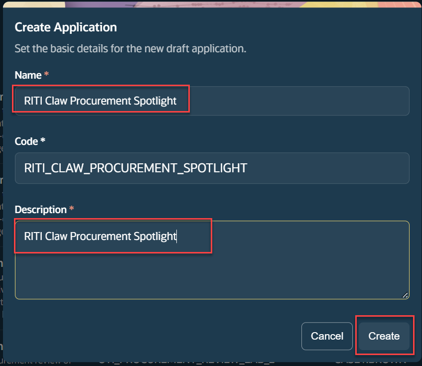
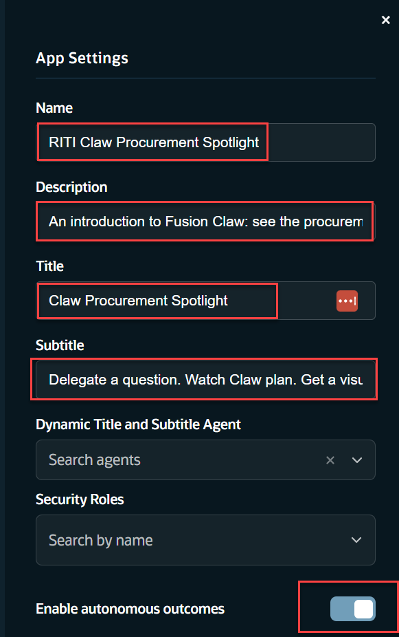
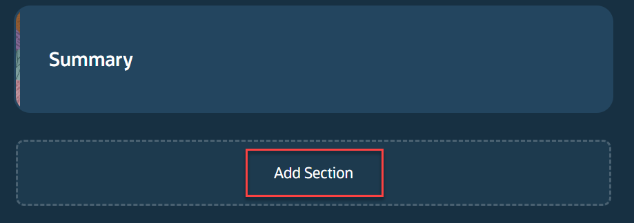
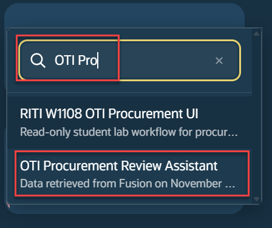
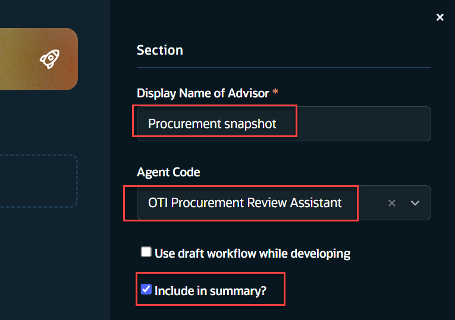

# Chapter 2 Creating the Agentic Application

[Previous: Introduction](../01-introduction/README.md) | [Next: Performing the Claw configuration](../03-configure-claw/configure_claw.md)

Students learn how to connect workflows to an application, enable autonomous outcomes, configure goals and skills, and add a suggested Research outcome. They then review Claw’s plan, run the outcome, inspect its briefing, and examine the Outcome Receipt. The exercise shows how governed, read-only automation can turn procurement data into actionable buyer recommendations while distinguishing potential price variances from verified savings.

## Create the application

1. From the AI Agent Studio landing page, select **Applications**.
2. Select **+ Add**.

3. Enter ***your initials*** followed by **Claw Procurement Spotlight** as the application name.
4. Provide the application description and select **Create**.

## Configure the application settings

Set the application values shown in the document:

| Field | Value |
| --- | --- |
| Name | ***<your initials>*** Claw Procurement Spotlight, using your initials in place of RITI |
| Title | Claw Procurement Spotlight |
| Subtitle | An introduction to Fusion Claw: see the procurement snapshot, then delegate a read-only visual briefing of the three largest price differences. |

The document also provides this display text:

> Delegate a question. Watch Claw plan. Get a visual procurement briefing.

## Add a section and select the workflow

1. Select **Add Section**.

2. Search for **OTI Procurement Review Assistant** and select the workflow.

## Configure the section

In the right-hand pane, set or verify these values:

| Field | Value |
| --- | --- |
| Display Name of Advisor | Procurement snapshot |
| Agent Code | Automatically populated; verify that the selected workflow is correct |
| Include in Summary | Checked |

[Previous: Introduction](../01-introduction/README.md) | [Next: Performing the Claw configuration](../03-configure-claw/README.md)

## Summary

You should now have a brief introductory understanding of some the tools and prompts used in this sample workflow. 
In the next lab we will add an additional node to expand the capabilities of this workflow.

[Proceed to the next lab](#next)

## Acknowledgements
* **Author** - 
* **Contributors** - 
* **Last Updated By/Date** - 
