# Chapter 3 Running the Application

[Previous: Performing the Claw configuration](../03-configure-claw/configure_claw.md) | [Chapter index](../01-introduction/README.md#chapters)

## Publish and open the application

1. Select **Publish** in the application builder toolbar.

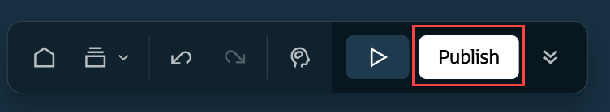

2. Review the confirmation and select **Publish**.

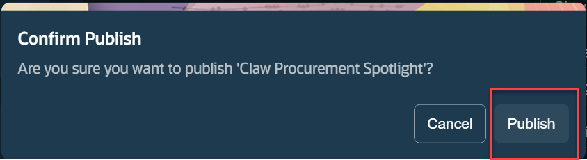

3. The published application should load and display data.

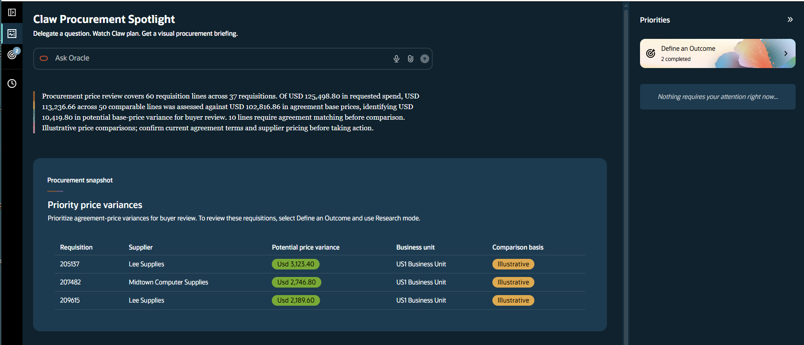

## Test the application with Ask Oracle

1. Enter this question in the main page **Ask Oracle** input:

```text
<copy>
Which three requisition lines should a buyer investigate first, why do they matter, and what should the buyer verify before taking action? Also summarize how many lines need agreement matching.
</copy>
```

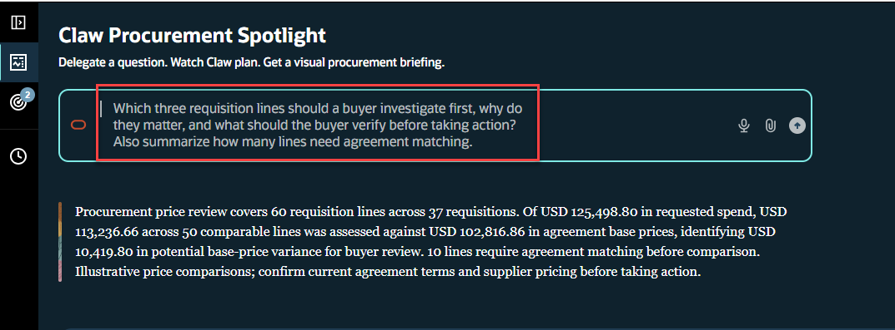

2. Select the submit arrow.
3. Review the response for the three requisitions, supplier names, price differences, and buyer verification steps.
4. Verify that unknown agreement comparisons are not assigned savings.

Ask Oracle provides an interactive answer. It does not require you to start a Claw Research outcome or generate an HTML file.

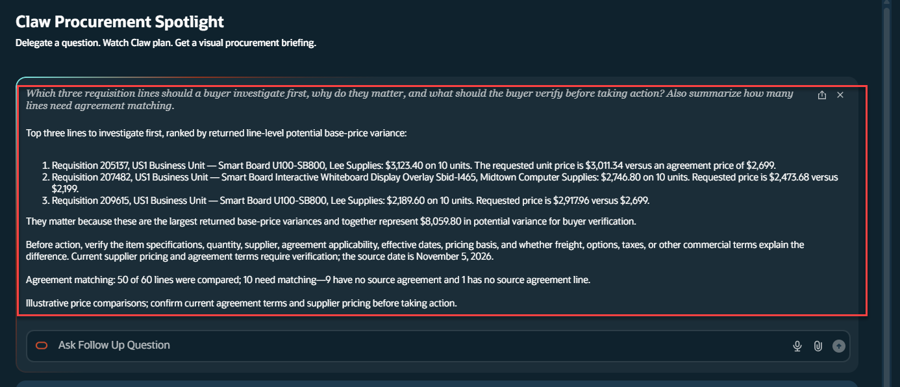

## Run the Fusion Claw outcome

1. Select **Define an Outcome**.

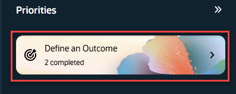

2. Select the **Prioritize buyer investigations** example card.
3. Confirm **Research** mode.
4. If the card has populated the request but not submitted it, select the submit arrow.

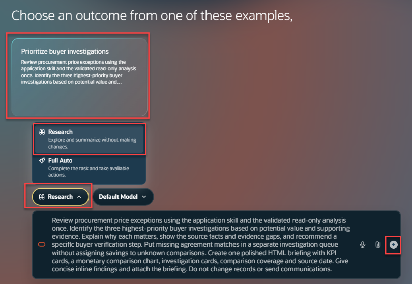

5. Review the generated plan. It should cover validated procurement analysis, three buyer investigations, evidence gaps, an agreement-matching queue, and an HTML briefing.
6. Select **Start**.

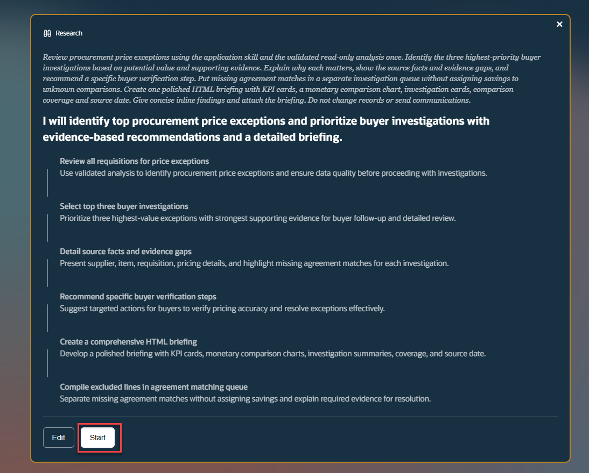

7. Allow the outcome to finish. HTML generation can take several minutes. Avoid submitting duplicate runs while one is already in progress.

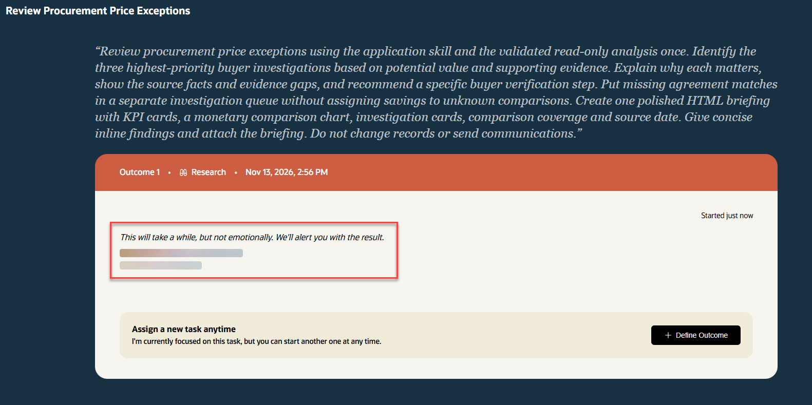

## Review the completed HTML briefing

When the outcome is **Completed**, open or expand the attached HTML briefing.

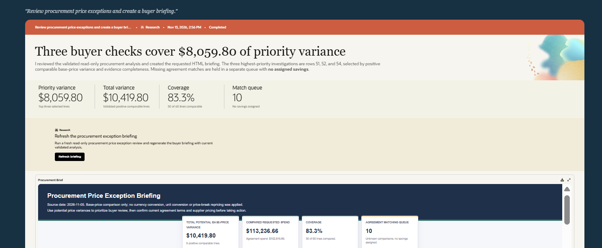

Check that the briefing contains:

- KPI cards and a monetary comparison chart.
- Three buyer investigation cards with source facts and evidence gaps.
- A specific buyer verification recommendation for each investigation.
- A separate agreement-matching queue: nine lines with no source agreement and one line with no source agreement line.
- Comparison coverage, source date, scope, and **Illustrative** labels.
- No savings assigned to the 10 unknown comparisons.

Verify the figures given in the document:

| Check | Expected value |
| --- | --- |
| Total potential variance | USD 10,419.80 |
| Total for the three selected investigations | USD 8,059.80 |

No business records should be changed and no communications should be sent.

## Check the Outcome Receipt

1. Scroll to the bottom of the page.
2. Select **Outcome Receipt** to review how the result was produced.

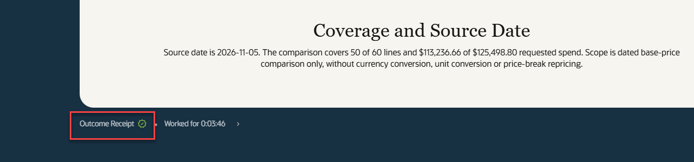

An Outcome Receipt is the execution record for a Claw outcome. It shows what Claw did to complete the request, including the steps performed, capabilities called, execution time, and completion status.

It records the execution; it does not independently verify that the findings are correct.

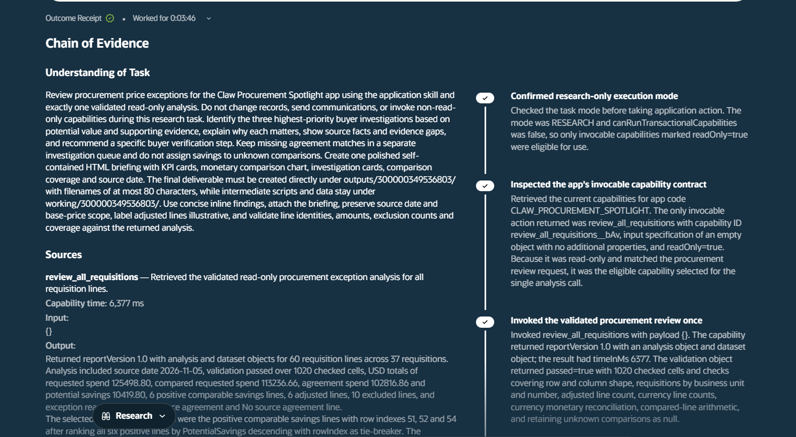

This concludes the demo.

[Previous: Performing the Claw configuration](../03-configure-claw/configure_claw.md) | [Return to the introduction](../01-introduction/README.md)
